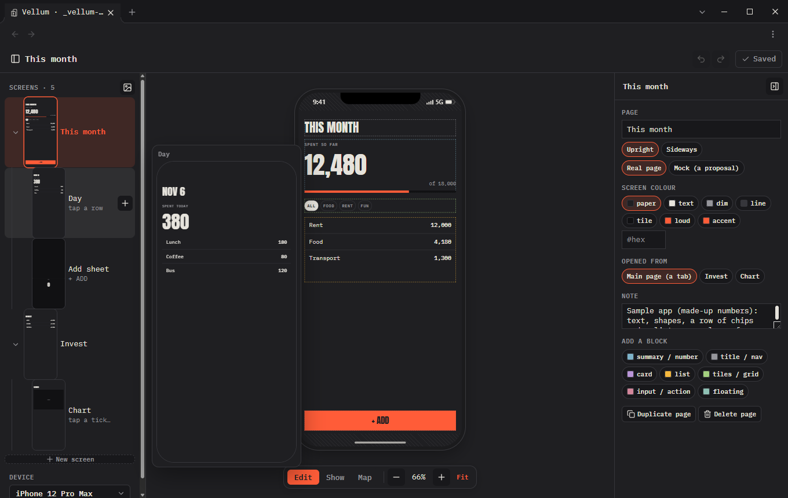
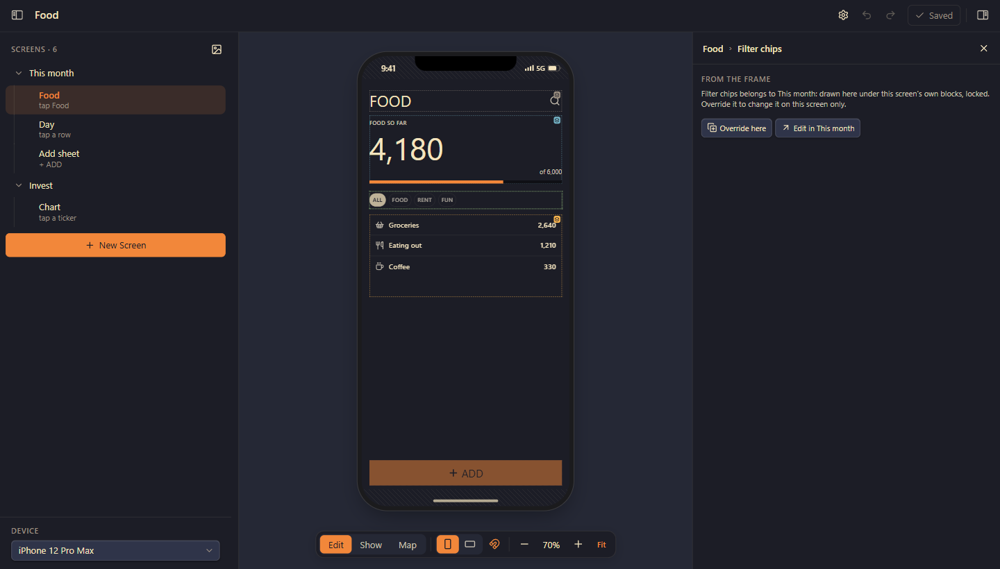
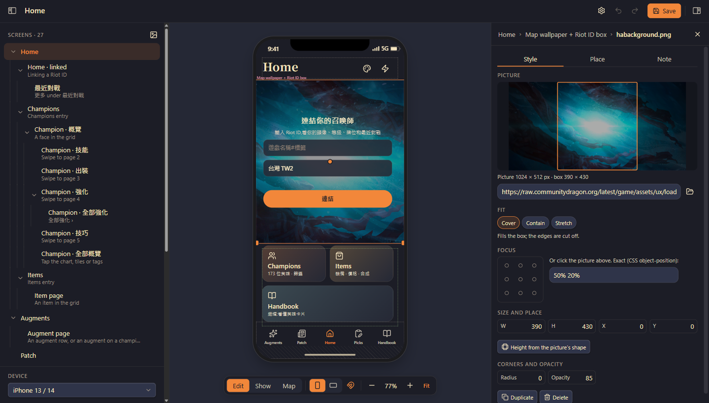
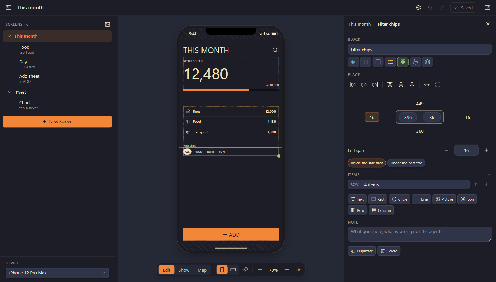
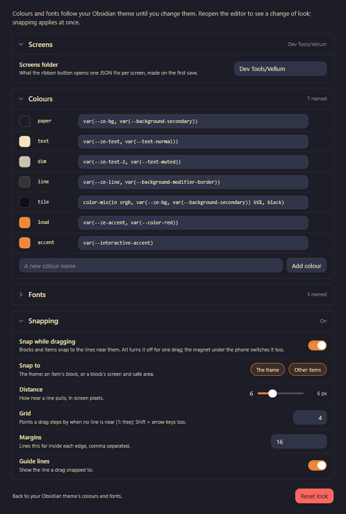

<p align="center">
  
</p>

<h1 align="center">Vellum</h1>

<p align="center">
  <b>Design app screens on real phone frames, together with your AI coding agent, inside Obsidian.</b><br>
  You move blocks on a phone. Your agent reads the exact layout as small JSON files.<br>
  No screenshots, no long descriptions.
</p>

<p align="center">
  <a href="https://github.com/zelvet-velvet/vellum/releases/latest"></a>
  <a href="https://github.com/zelvet-velvet/vellum/releases"></a>
  <a href="https://obsidian.md"></a>
  <a href="LICENSE"></a>
  <a href="https://ko-fi.com/zelvet_velvet"></a>
</p>

<p align="center">
  <a href="#quick-start">Quick start</a> ·
  <a href="#install">Install</a> ·
  <a href="#the-editor">The editor</a> ·
  <a href="#design-with-an-ai-agent">AI agents</a> ·
  <a href="#file-format">File format</a> ·
  <a href="#faq">FAQ</a>
</p>

<p align="center">
  
</p>

## Why Vellum

Describing a layout to a coding agent in words is slow, and screenshots are guesswork for both of you. Vellum is the **tracing paper** between you and the agent:

- **You** see every screen on a real phone frame and fix it by hand: drag, resize, snap, retype.
- **The agent** reads and writes each screen as a small JSON file: exact positions, sizes, colours, text.
- **Git** shows precisely what changed, one screen per file, one block per line.

The screens of [Morellonomicon](https://github.com/zelvet-velvet/Morellonomicon) and ZeLedger were designed this way, with Claude Code.

## Features

| | |
| :--- | :--- |
| 📱 **Real devices** | iPhone 12 – 17 (mini, Pro, Pro Max, Air, SE), Pixel 8, Galaxy S24 / S25 / S25 Ultra, with the cut-out, status bar, home strip and safe areas; or any custom width × height. |
| 🔄 **Portrait and landscape** | Each screen has a portrait layout and, if you make one, a landscape layout. One switch turns the editor, the tree and the map. |
| 🧱 **Blocks and items** | A screen is made of blocks (title, summary, list, action…). Blocks hold text, shapes, pictures and icons placed by **gravity**: 9 anchor points, an offset, and hug / fixed / fill per axis. Rows and columns hold repeated items. |
| 🖼️ **Pictures and icons** | Pictures by `https://` address or vault path, with fit, focus and corner radius. Icons by Lucide name, Obsidian's own set. |
| 🧩 **Frames** | A screen can sit on its parent's frame, a layout template: it draws the frame's blocks under its own and stores only what it overrides. |
| 🧲 **Snapping** | Blocks and items snap to edges, middles, margin lines and each other, with guide lines. |
| 🗺️ **Screen map** | Every screen as a small phone, sub screens under the screen they open from, joined by how you get there. |
| 🖥️ **Fits the device** | On a computer the editor opens in its own window, with a screens tree, the phone and a settings panel; on a phone it takes the full screen with a bottom sheet. |
| 📄 **Plain text** | One screen per line in a note, or one JSON file per screen in a folder. Unsaved work is kept on the device until you save. |

<table>
  <tr>
    <td width="50%" align="center"><br><sub><b>Map</b>: every screen as a tree</sub></td>
    <td width="50%" align="center"><br><sub><b>Peek</b>: rest the pointer on a screen</sub></td>
  </tr>
  <tr>
    <td align="center"><br><sub><b>Frames</b>: inherited blocks are faded and locked; override one, or edit it where it belongs</sub></td>
    <td align="center"><br><sub><b>Pictures</b>: the part the box shows is framed; click or drag to choose it</sub></td>
  </tr>
  <tr>
    <td align="center"><br><sub><b>Snapping</b>: edges and middles snap, with guide lines</sub></td>
    <td align="center"><br><sub><b>Settings</b>: colours, fonts, snapping</sub></td>
  </tr>
</table>

<p align="center"><sub>A made-up budget app (<a href="examples/Vellum%20Demo.md"><code>examples/Vellum Demo.md</code></a>) in ZeLedger's "Popping and Locking" colours; the picture is Morellonomicon's Home screen.</sub></p>

## Quick start

1. [Install](#install) Vellum and enable it in **Settings → Community plugins**.
2. Click the **Vellum** button in the ribbon. The editor opens on your screens folder (`Screens` by default, made on the first save).
3. Click **New Screen**, add a block from the screen's settings, and start placing items. Press **Ctrl+S** to save.

To try it with sample screens, copy [`examples/Vellum Demo.md`](examples/Vellum%20Demo.md) into your vault and open it in Reading view.

## Install

**Community plugins** (coming soon): search for **Vellum** in Settings → Community plugins.

**BRAT**: in [BRAT](https://github.com/TfTHacker/obsidian42-brat), add the beta plugin `zelvet-velvet/vellum`.

<details>
<summary><b>Manual</b></summary>

1. Download `main.js`, `manifest.json` and `styles.css` from the [latest release](https://github.com/zelvet-velvet/vellum/releases/latest).
2. Put them in `<your vault>/.obsidian/plugins/vellum/`.
3. Reload Obsidian and enable **Vellum** in Settings → Community plugins.

</details>

## The editor

Open it from the ribbon button or the command **Vellum: Open the screens**. **Vellum: Open screens from another folder** switches folders. You can also show screens inside a note as a card, with the screen map and **Open editor**:

````markdown
```vellum
```
````

| Area | What it does |
| :--- | :--- |
| **Top bar** | Show / hide the screens tree, the screen's name, Vellum's settings, undo, redo, Save, and the settings panel toggle. |
| **Screens tree** | Every screen, sub screens under the screen they open from (a chevron folds a branch). Rest the pointer on one (long press on a phone) for a large look. **+** adds a screen opened from it; the device sits at the foot. |
| **The phone** | Click a block, then a text or shape in it. Drag to move, drag a block's corner to resize, double-click a text to type. Click beside the phone to let go. |
| **Pill under the phone** | Edit / Show / Map, Portrait / Landscape, snapping on or off (the magnet), zoom and Fit. |
| **Settings panel** | Only what is chosen. With nothing chosen: the screen itself (name, colour, opened from and its frame, safe areas, note). |
| **A block's place** | Align it in the screen, see its size with its distance to each edge around it, and step any distance with − / +. |
| **Safe areas** | Shaded while editing. Blocks stay out of them unless the block's **Under the bars too** is on. Their size is set per doc and orientation. |
| **Frames** | On a screen that uses its parent's frame, the frame's blocks are faded and locked: **Override here** copies one onto this screen, **Edit in** jumps to the screen it belongs to. An override has a small mark and **Back to the frame**. |
| **Pictures** | A chosen picture, rectangle or circle has a handle at both bottom corners. A picture's settings show the whole picture with the part its box shows framed. |

### Keyboard and mouse

| Shortcut | Action |
| :--- | :--- |
| <kbd>←</kbd> <kbd>→</kbd> <kbd>↑</kbd> <kbd>↓</kbd> | Nudge 1 pt (with <kbd>Shift</kbd>: one grid step, 4 pt by default) |
| <kbd>Ctrl</kbd> + <kbd>Z</kbd> / <kbd>Ctrl</kbd> + <kbd>Shift</kbd> + <kbd>Z</kbd> | Undo / redo |
| <kbd>Ctrl</kbd> + <kbd>D</kbd> | Duplicate |
| <kbd>Delete</kbd> | Delete the chosen block or item |
| <kbd>Ctrl</kbd> + <kbd>S</kbd> | Save |
| <kbd>Esc</kbd> | Go up a level (item → block → screen); at the top, close the editor |
| <kbd>Alt</kbd> while dragging | No snapping, 1 pt steps |
| <kbd>Shift</kbd> while resizing | Keep the shape |
| <kbd>Ctrl</kbd> + wheel | Zoom |

## Design with an AI agent

Vellum works with any coding agent that can read and write files: Claude Code, Codex, Cursor and others. It needs no plugin API and no server.

### Set up once

1. Keep your screens as a folder in the vault, one file per screen. The ribbon button makes `Screens/` on the first save.
2. Tell your agent where the folder is, and point it to the [file format](#file-format) (or to this README).

### The loop

1. **The agent drafts.** It records your app's real screens or proposes new ones, with real text, pictures by address (`img`), icons by Lucide name (`icon`), and frames (`inherit`) for screens that share a layout.
2. **You adjust.** In the editor you drag, resize, snap and retype, and you write what you want in a block's or an item's **Note** ("too crowded", "this should scroll"). Then save.
3. **The agent builds.** It reads the screens you changed (git shows exactly which lines), follows your notes, and changes the app to match, or writes the next version of the screen for you to review.

A prompt to start with:

```text
Read the README of github.com/zelvet-velvet/vellum for the file format.
Then record each page of my app as a Vellum screen in Design/Screens:
one JSON file per screen, real text, pictures by https address, icons by Lucide name.
Keep block and item ids stable when you change a screen later.
```

### Tips

- **Ask for mocks.** Two or three proposals as sub screens of the real one, with `"mock": true`; keep the one you like.
- **Keep ids stable.** The agent should change a block in place rather than write a new one, so diffs stay small and frames keep their overrides.
- **Name things.** Block kinds (title, list, card, action…) and names tell the agent what each part is for; notes tell it what to do.
- **Work at the same time.** The agent can write while the editor is open: Vellum reloads changed files by itself, and offers your unsaved edits back instead of overwriting them.

## Theming

Items use named colours (`paper`, `text`, `dim`, `line`, `tile`, `loud`, `accent`) and fonts (`ui`, `display`, `mono`). By default they follow your Obsidian theme. **Settings → Vellum** sets each one to any CSS value, including a CSS variable of your own theme or plugin, and adds new names. An item can also take a `#hex` colour or a font stack directly.

## File format

A doc is a device and a list of pages (screens); a page has blocks; a block has items.

```json
{"id": "demo", "device": "iphone-16-pro", "pages": [
  {"id": "home", "name": "Home", "bg": "paper", "blocks": [
    {"id": "b1", "name": "Title", "kind": "nav", "x": 16, "y": 70, "w": 370, "h": 44, "items": [
      {"id": "t1", "type": "text", "v": "HOME", "font": "display", "size": 32, "g": "l"}]}]},
  {"id": "detail", "name": "Detail", "parent": "home", "link": "tap a row", "blocks": []}
]}
```

<details open>
<summary><b>Field reference</b></summary>

**Doc**

| Field | Meaning |
| :--- | :--- |
| `device` | The phone every screen is drawn on (a page may override it) |
| `safe`, `safeLand` | The doc's safe areas, portrait / landscape: `top bottom left right`, each optional (else the device's own) |

**Page** (a screen)

| Field | Meaning |
| :--- | :--- |
| `name`, `note` | Its name, and a note for the agent |
| `parent`, `link` | The screen it opens from, and how (`"tap a row"`) |
| `inherit` | `true`: the parent is its frame (see below) |
| `device`, `bg`, `mock` | A device override, the screen colour, a proposal |
| `blocks`, `land` | The portrait layout, and the landscape one if it has one |

**Block**

| Field | Meaning |
| :--- | :--- |
| `name`, `kind`, `note` | What it is (title, summary, list, card, action…) and a note |
| `x y w h` | Position and size in screen points |
| `bleed` | `true`: it may go into the safe areas |
| `items` | Its items |

**Item**

| Type | Fields |
| :--- | :--- |
| all | `g` (gravity: `tl t tr l c r bl b br`), `dx dy` (offset), `w h` (a number, `"hug"` or `"fill"`), `op`, `note` |
| `text` | `v size wt font color ls lh upper` |
| `rect` `ellipse` `line` | `fill stroke sw r` |
| `img` | `src` (`https://…` or a vault path), `fit` (`cover`, `contain` or `fill`), `pos` (CSS object-position, default `center`), `r` |
| `icon` | `name` (a Lucide name), `color size sw` |
| `row` `col` | `items gap pad main cross`, plus `fill stroke sw r` |

</details>

**Frames.** A page with `"inherit": true` draws its parent's blocks (and theirs, if the parent inherits too) under its own, in the same layout, and uses its parent's `bg` unless it has one. An own block with the same `id` as one of the frame's takes that block's place (an override); the page stores only its own blocks and overrides.

### Bigger apps: a folder

For more than a handful of screens, keep them as files and point a block at the folder:

````markdown
```vellum
src: Design/Screens
```
````

The folder holds one file per screen (`Home.json`, `Detail.json`…, named after the screen, its blocks one per line) and `_doc.json` (`id`, `device`, `order`, and the safe areas if set).

- A save writes only the screens that changed. A renamed screen gets a new file name; a deleted one goes to the trash.
- Files changed outside the editor (your agent, a sync) are read again by themselves; unsaved edits are offered back, never overwritten.
- An agent reads or writes just the screen it works on.

## FAQ

<details>
<summary><b>Does Vellum send anything over the network?</b></summary>

No. Vellum makes no network requests of its own. A picture item whose `src` is an `https://` address is loaded from that address when the screen is drawn, as an image in a note would be; vault paths are read from the vault.

</details>

<details>
<summary><b>Does it work on a phone?</b></summary>

Yes. On a phone the editor takes the full screen, with the settings in a bottom sheet and a writing window that stays above the keyboard.

</details>

<details>
<summary><b>Does it need a particular agent?</b></summary>

No. Any agent that can read and write files works. The format is plain JSON, described above.

</details>

<details>
<summary><b>Where is unsaved work kept?</b></summary>

On the device, in Obsidian's storage for that vault, until you save. If the files changed meanwhile, the editor shows the files and offers your edits back.

</details>

## Development

```sh
npm install
npm run check && npm run build
npm run install-vault -- /path/to/vault
```

The source is in `src/`: `model.ts` (the format), `render.ts` (drawing items), `editor.ts` (the editor), `devices.ts` (phones and safe areas), `store.ts` (folder docs), `local.ts` (per-vault device storage), `main.ts` (the plugin and its settings). Issues and pull requests are welcome.

## Support

Vellum is free and open source, made in my spare time. If it saves you time, a coffee keeps it going. Thank you!

<a href="https://ko-fi.com/zelvet_velvet"></a>

## License

[MIT](LICENSE) © Zaviel
