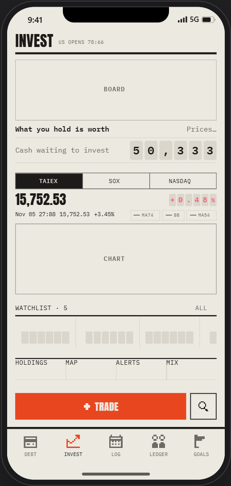
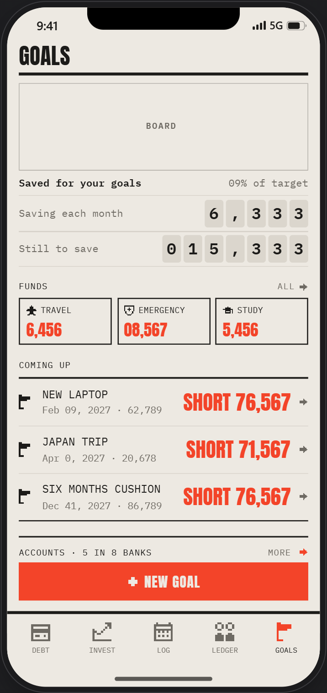
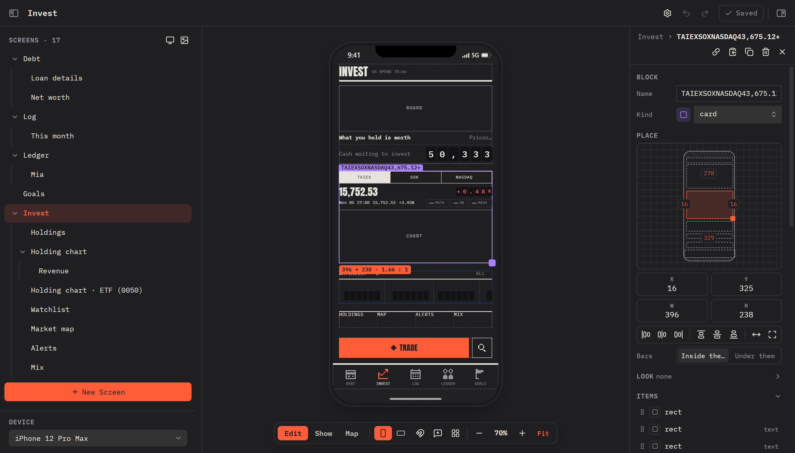
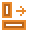
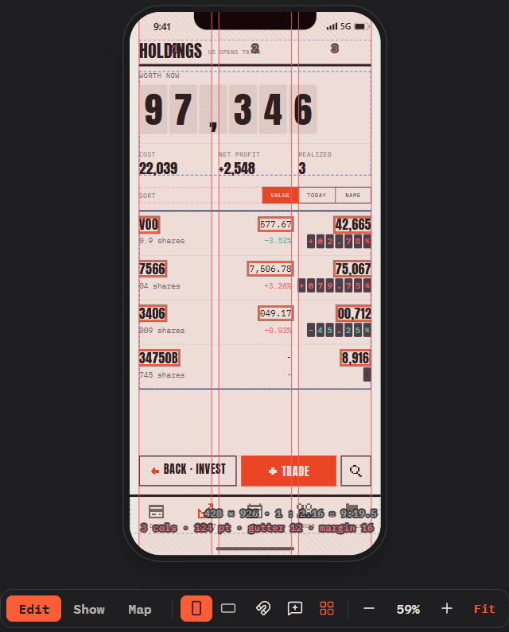
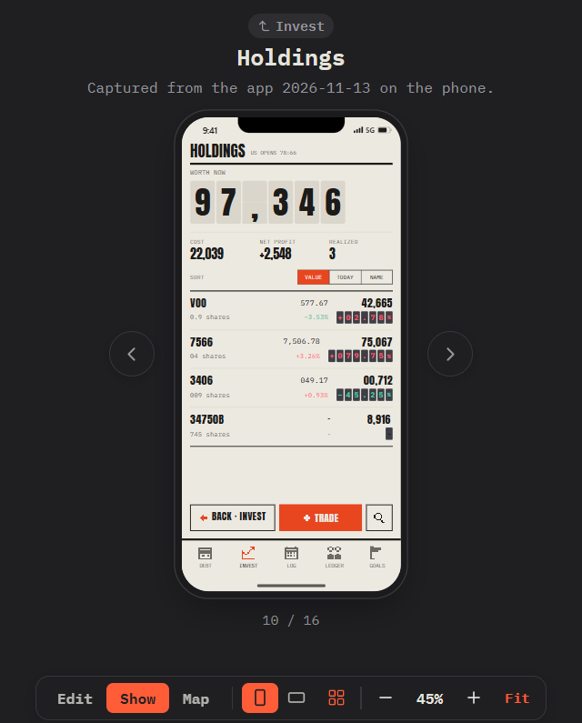
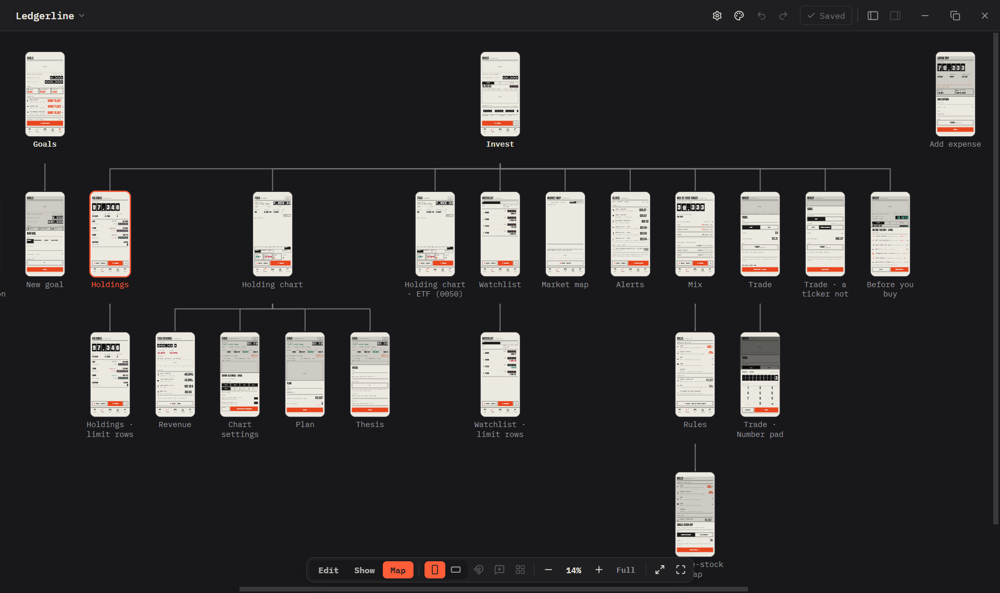
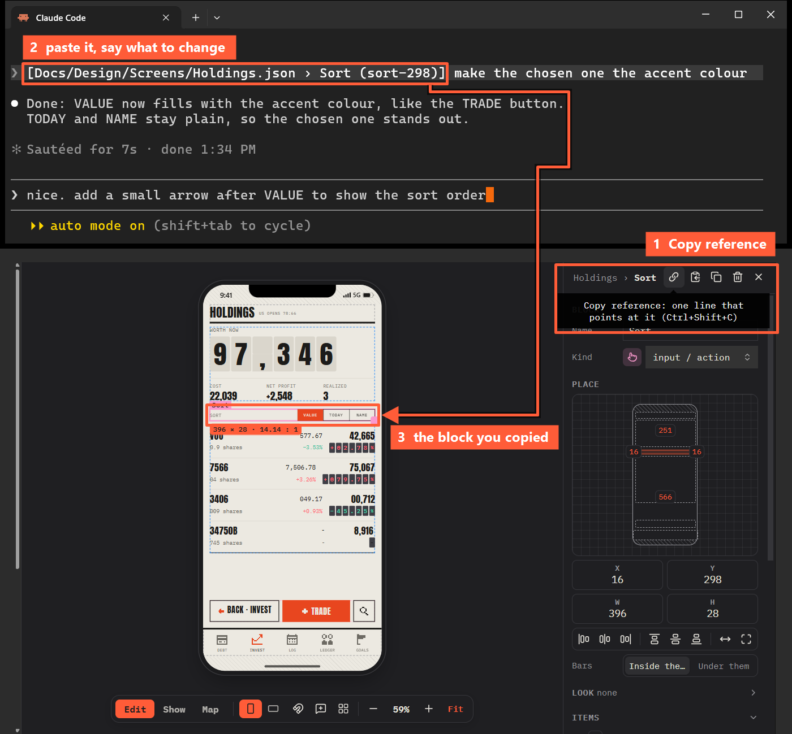
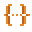

<h1 align="center">Vellum</h1>

<p align="center">
  <b>Draft app screens inside Obsidian, together with your coding agent.</b>
</p>

<p align="center">
  <b>English</b> · <a href="README.zh-TW.md">繁體中文</a>
</p>

<p align="center">
  <a href="https://github.com/zelvet-velvet/vellum/releases/latest"></a>
  <a href="https://obsidian.md"></a>
  <a href="LICENSE"></a>
</p>

<p align="center">
  
</p>

A light plugin for UI drafts that never leaves your vault: no design app, no website, no account. Lay screens out on a real device frame (a phone, a tablet, a desktop window or any size you set); each one is a small JSON file, so any agent that can open the vault reads exactly where everything is and edits the same files. No screenshots, no long descriptions.

- **Any app, any screen**: a phone app, a desktop window, a web page or an Obsidian plugin; a side project or a work project. Several apps share a vault, each in its own folder with its own device. If your notes live in Obsidian, its screens can too.
- **Point at a piece, ask for a change**: copy a block or an item for the agent in one click, say what to change, see it on the phone.
- **Talk through the flow, not just the pixels**: the Map shows how the screens connect, so you and the agent can work out the app's logic and UX together.

Colours, fonts and icons come from your Obsidian theme, so a plugin's mockup already looks like the plugin.

<sub>The JSON is a layout intent, not native layout code. It maps directly to HTML and CSS, so to Obsidian plugins; for SwiftUI or Compose, see the [FAQ](#-faq).</sub>

<p align="center">
  <a href="#-install">Install</a> ·
  <a href="#-quick-start">Quick start</a> ·
  <a href="#-with-your-agent">With your agent</a> ·
  <a href="#-file-format">File format</a> ·
  <a href="#-faq">FAQ</a>
</p>

<table>
  <tr>
    <td width="25%"></td>
    <td width="25%"></td>
    <td width="25%"></td>
    <td width="25%"></td>
  </tr>
</table>

<p align="center"><sub>Screens of Ledgerline, a personal finance app built in Obsidian, designed in Vellum with Claude Code. Every number is made up.</sub></p>

<p align="center"></p>

##  Features

<table>
  <tr>
    <td width="33%" valign="top"><br><b>Real devices</b><br><sub>iPhone 12 – 17, Pixel 8, Galaxy S24 / S25, or any size (a desktop window, a tablet, a panel), with cut-outs, safe areas, your own corner and status bar.</sub></td>
    <td width="33%" valign="top"><br><b>Portrait and landscape</b><br><sub>A layout for each, one switch for the whole editor.</sub></td>
    <td width="33%" valign="top"><br><b>Blocks and gravity</b><br><sub>Text and shapes keep an anchor point, an offset, and hug / fixed / fill sizes.</sub></td>
  </tr>
  <tr>
    <td valign="top"><br><b>Pictures and icons</b><br><sub>Images by address or vault path; Lucide icons by name.</sub></td>
    <td valign="top"><br><b>Frames</b><br><sub>Screens share a layout and store only what they change.</sub></td>
    <td valign="top"><br><b>Snapping</b><br><sub>Edges, middles, margins and neighbours, with guide lines.</sub></td>
  </tr>
  <tr>
    <td valign="top"><br><b>Screen map</b><br><sub>Every screen as a tree, joined by how you get there.</sub></td>
    <td valign="top"><br><b>Its own window</b><br><sub>A full editor on a computer, a bottom sheet on a phone. Show walks the screens as a preview.</sub></td>
    <td valign="top"><br><b>Plain JSON</b><br><sub>One file per screen, one block per line. Small diffs.</sub></td>
  </tr>
  <tr>
    <td valign="top"><br><b>Marks</b><br><sub>Notes, named areas and guide lines on the screen, for you and the agent.</sub></td>
    <td valign="top"><br><b>Overlays</b><br><sub>Grids, columns, thirds, the golden ratio and spiral, vanishing points.</sub></td>
    <td valign="top"><br><b>Choose and group</b><br><sub>Drag an area over blocks or items, move them together, group them.</sub></td>
  </tr>
</table>

<table>
  <tr>
    <td width="50%" align="center"><br><sub><b>Overlays</b>: three columns; the list's names, prices and values line up with them</sub></td>
    <td width="50%" align="center"><br><sub><b>Show</b>: the screen as a preview, the way here above, the next screen beside</sub></td>
  </tr>
</table>

<p align="center"><br><sub><b>Map</b>: every screen as a tree, joined by how you get there; a click opens one</sub></p>

##  Install

- **[Community plugins](https://obsidian.md/plugins?id=vellum)**: in **Settings → Community plugins → Browse**, search for **Vellum**, install and enable it.
- **[BRAT](https://github.com/TfTHacker/obsidian42-brat)**: add the beta plugin `zelvet-velvet/vellum`.
- **Manual**: copy `main.js`, `manifest.json` and `styles.css` from the [latest release](https://github.com/zelvet-velvet/vellum/releases/latest) into `<vault>/.obsidian/plugins/vellum/`, then enable **Vellum**.

##  Quick start

1. Click **Vellum** in the ribbon. The editor opens on `Screens/`.
2. **New Screen**, add a block, place items in it.
3. **Ctrl+S** to save.

Want sample screens? Copy [`examples/Vellum Demo.md`](examples/Vellum%20Demo.md) into your vault.

##  With your agent

Any agent that reads and writes files works: Claude Code, Codex, Cursor. No plugin API, no server.

1. **The agent drafts** your app's screens, or proposes new ones.
2. **You point and ask**: choose a block, press **Copy reference** (<kbd>Ctrl</kbd> <kbd>Shift</kbd> <kbd>C</kbd>), paste it to the agent with what to change. Or leave a **mark** on the screen: a pinned note, a named area, a guide line. The agent can answer with marks of its own.
3. **The agent builds** from the screens you changed.

<p align="center"><br><sub><b>1</b> Copy reference on a block, <b>2</b> paste it to the agent with what to change, <b>3</b> the phone updates as the file changes.</sub></p>

<table>
  <tr>
    <td width="36%" valign="top"></td>
    <td valign="top">

The card with the mix bars, as its file holds it:

```json
{"name": "Mix vs your target", "kind": "card",
 "x": 16, "y": 323, "w": 396, "h": 183, "items": [
  {"type": "text", "v": "MIX VS YOUR TARGET", "size": 12},
  {"type": "text", "v": "5 WARNINGS", "dx": 286, "color": "dim"},
  {"type": "text", "v": "ETFs", "dy": 29, "size": 15},
  {"type": "rect", "dy": 54, "w": 396, "h": 16, "fill": "dim"}
]}
```

One screen is one small file. The agent reads exactly where each thing is, and changes only what it needs to.

</td>
  </tr>
</table>

Start your agent with this; the [guide for agents](docs/for-agents.md) tells it what Vellum can do:

```text
Read github.com/zelvet-velvet/vellum/blob/main/docs/for-agents.md.
Write each page of my app as a Vellum screen in Design/Screens, then tell me the folder.
When I ask for options, make them as Vellum mocks, not as a web page.
```

The guide also ships with Vellum, for an agent without network: the command **Vellum: Add the agent guide to an app's folder** writes it into the app's folder as `VELLUM.md`, and **Add the agent guide as a Claude Code skill** writes it to `.claude/skills/vellum/`. Each matches the Vellum you have, and is written again when Vellum updates. The agent then reads `VELLUM.md` instead of the link.

> [!TIP]
> Frames belong to what they frame: a block has its own `fill`, `stroke` and `sides`, a text its own box. A rectangle drawn as a frame (an older screen) shows **Make it the block's look** or **Make it the text's box** when you choose it.
>
> Ask for two or three **mocks** (`"mock": true`) as sub screens and keep the one you like. The agent can write while the editor is open: Vellum reloads the files and never overwrites your unsaved edits.

<sub>The screens of [Morellonomicon](https://github.com/zelvet-velvet/Morellonomicon) and Ledgerline were designed this way, with Claude Code.</sub>

##  File format

One folder per app, one small file per screen:

```text
Design/Screens/
├─ _doc.json       the device: size, safe areas, corner, status bar; the screen order
├─ Home.json       a screen
└─ Settings.json   another screen
```

A screen is a few **blocks**, boxes on the phone. Each block holds **items**, placed by an anchor:

```jsonc
{"id": "home", "name": "Home", "blocks": [
  {"id": "title", "name": "Title", "kind": "nav", "x": 16, "y": 70, "w": 396, "h": 44,    // a box, in points
   "items": [
     {"id": "t1", "type": "text", "v": "HOME", "font": "display", "size": 32, "g": "l"},  // left, centred down
     {"id": "i1", "type": "icon", "name": "settings", "g": "r"}                          // right: a Lucide icon
   ]}
]}
```

Show the screens in a note with a code block `vellum` holding `src: Design/Screens`. Every field is below; agents have [their own guide](docs/for-agents.md).

<details>
<summary><b>Field reference</b></summary>

| Level | Fields |
| :--- | :--- |
| **Doc** | `device`; `safe`, `safeLand` (`top bottom left right`, each optional); `radius` (the screen's corner, `0` for a square screen; else the device's); `bar` (the status bar: `style` `ios`, `android` or `none`, `fill`, `ink`, `time`; as high as `safe.top` when that is set) |
| **Page** | `name`, `note`, `parent`, `link` (how you get there), `inherit` (`true`: the parent is its frame), `device`, `bg`, `mock`, `blocks`, `land` (the landscape layout), `marks` |
| **Block** | `name`, `kind`, `note`, `x y w h` (screen points), `bleed` (`true`: may go into the safe areas; a block wholly outside the screen is a **draft**, kept beside it in the editor and not built), its own look: `fill stroke sw r` and `sides` (the outline on some sides only: `"b"`, `"tb"`…), `items` |
| **Any item** | `g` (anchor: `tl t tr l c r bl b br`), `dx dy`, `w h` (a number, `"hug"` or `"fill"`), `op`, `note` |
| `text` | `v size wt font color ls lh upper`, and a box of its own: `fill stroke sw r pad` (a chip, a tile, a button; with a set `h` the text sits in its middle) |
| `rect` `ellipse` `line` | `fill stroke sw r` (`r`: one radius, or four: `[tl, tr, br, bl]`) |
| `img` | `src` (`https://…` or a vault path), `fit` (`cover` · `contain` · `fill`), `pos` (CSS object-position), `r` |
| `icon` | `name` (Lucide), `color size sw` |
| `row` `col` | `items gap pad main cross`, `fill stroke sw r` |
| `group` | `items`, each placed in the group's `w h` box by its own `g dx dy`; moved as one |
| **Mark** | A note on the screen for you and the agent, never part of the design: `id`, `kind` (`note`: a pin · `area`: a box `w h` with a `guide` in it if wanted, `thirds phi spiral diag center` · `line`: `axis` `"x"` down or `"y"` across), `x y`, `text`, `color`, `size` (its text's size, 11 if not set), `w` on a note (its bubble's width, else as wide as its text), `land`, `by` (`"agent"`) |

**Frames.** A page with `"inherit": true` draws its parent's blocks under its own. An own block with the same `id` replaces the parent's one; the page stores only its own blocks.

**Colours and fonts.** Items use theme names (`paper text dim line tile loud accent`; `ui display mono`), set in Settings → Vellum, or any CSS value. The editor's own panels follow your Obsidian theme, or the Editor theme colours in the same settings.

</details>

##  Shortcuts

| | |
| :--- | :--- |
| <kbd>←</kbd> <kbd>→</kbd> <kbd>↑</kbd> <kbd>↓</kbd> | Nudge 1 pt, with <kbd>Shift</kbd> one grid step |
| <kbd>Ctrl</kbd> <kbd>Z</kbd> · <kbd>Ctrl</kbd> <kbd>Shift</kbd> <kbd>Z</kbd> | Undo · redo |
| <kbd>Ctrl</kbd> <kbd>D</kbd> · <kbd>Delete</kbd> | Duplicate · delete |
| <kbd>Ctrl</kbd> <kbd>S</kbd> | Save |
| <kbd>Alt</kbd> / <kbd>Shift</kbd> while dragging | No snapping · keep the shape |
| Middle button, drag · <kbd>Ctrl</kbd> + wheel | Move the view · zoom at the pointer (up to 1600 %) |
| Drag on empty space · with <kbd>Ctrl</kbd> | Choose the blocks inside the area (or the items it crosses) · always the items |
| <kbd>Shift</kbd> click · <kbd>Ctrl</kbd> <kbd>A</kbd> | Add to the chosen or take out · every block |
| <kbd>Ctrl</kbd> <kbd>G</kbd> · <kbd>Ctrl</kbd> <kbd>Shift</kbd> <kbd>G</kbd> | Group the chosen items · ungroup (a group, row or column: its items stay where they are) |
| <kbd>N</kbd> · <kbd>Shift</kbd> <kbd>N</kbd> | The mark tool (a click: a note, a drag: an area) · show / hide the marks |
| <kbd>Ctrl</kbd> <kbd>'</kbd> | Show / hide the overlays |
| <kbd>Ctrl</kbd> <kbd>Shift</kbd> <kbd>C</kbd> | Copy a reference to the chosen screen, block or item, for the agent |
| <kbd>←</kbd> <kbd>→</kbd> in Show | The previous · the next screen |
| Hold a number box, then drag up / down | Change it (a click types; <kbd>↑</kbd> <kbd>↓</kbd> step it, with <kbd>Shift</kbd> ×10) |

##  FAQ

<details>
<summary><b>Does Vellum use the network?</b></summary>

Only to show a picture whose `src` is an `https://` address, as an image in a note would. Vellum makes no requests of its own.
</details>

<details>
<summary><b>Can I use it for a native iOS or Android app?</b></summary>

Yes, as a sketch your agent translates. Inside a block, items are placed the way native layouts work:

| Vellum | SwiftUI | Compose |
| :--- | :--- | :--- |
| anchor point (`g`) | `alignment` | `Alignment` |
| `"hug"` / `"fill"` | `.fixedSize()` / `.frame(maxWidth: .infinity)` | `wrapContentSize()` / `fillMaxWidth()` |
| `row` / `col` | `HStack` / `VStack` | `Row` / `Column` |

Blocks themselves sit at fixed positions on the screen, so the agent turns those into stacks and spacing.
</details>

<details>
<summary><b>Can I use it for a desktop app or a web page?</b></summary>

Yes. Give the folder a custom size, the window's own (`"device": "custom-1280x800"`), with `"bar": { "style": "none" }` and `"radius": 0` for a plain rectangle. A screen can take another size of its own, for a dialog or a smaller window. Each app is its own folder, so a phone app and its desktop companion sit side by side in one vault.
</details>

<details>
<summary><b>Does it work on a phone?</b></summary>

Yes. The editor takes the full screen, with its settings in a bottom sheet.
</details>

<details>
<summary><b>Where is unsaved work kept?</b></summary>

On the device, in Obsidian's storage for that vault, until you save.
</details>

<details>
<summary><b>How do I build it?</b></summary>

```sh
npm install && npm run check && npm run build
npm run install-vault -- /path/to/vault
```
</details>

##  Support

Vellum is free and made in my spare time. If it helps you, a coffee keeps it going.

<a href="https://ko-fi.com/zelvet_velvet"></a>
