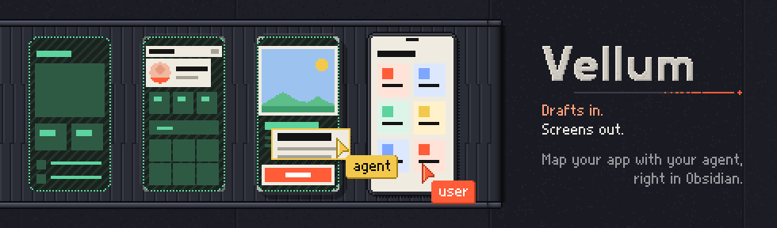
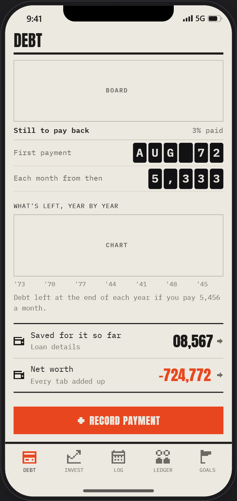
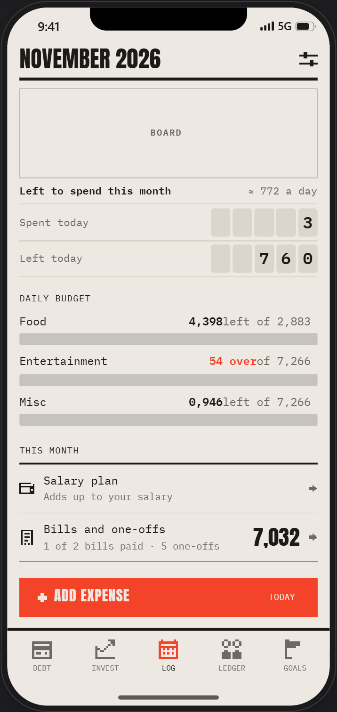
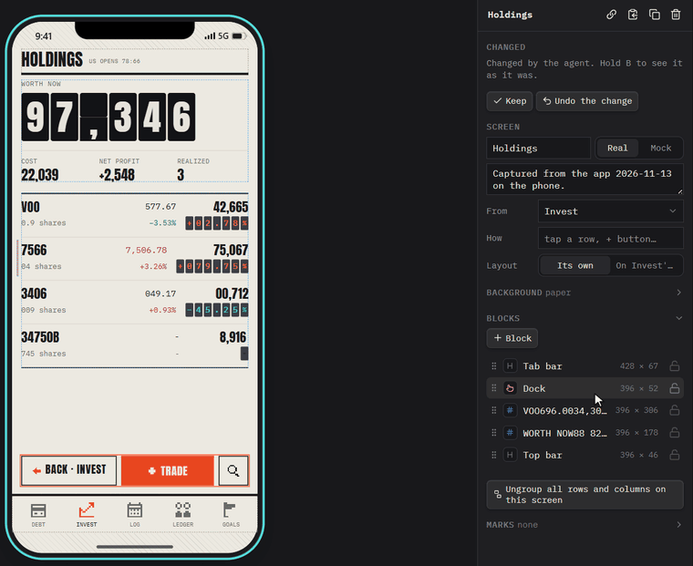
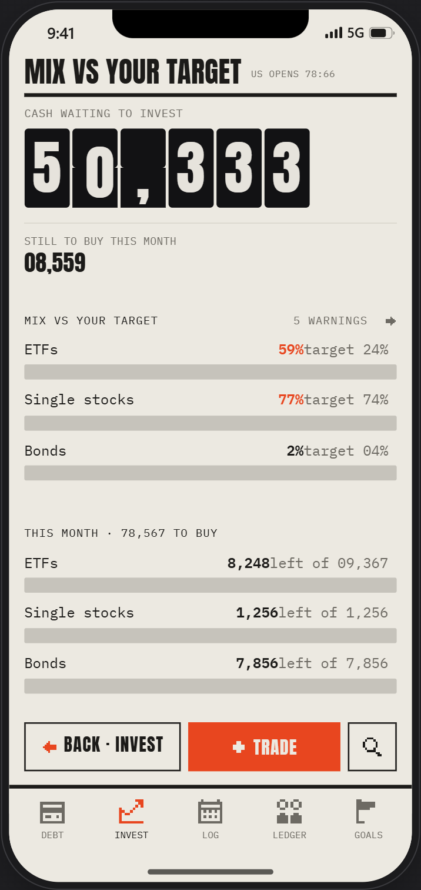

<h1 align="center">Vellum</h1>

<p align="center">
  <b>Draft app screens inside Obsidian, together with your coding agent.</b>
</p>

<p align="center">
  <b>English</b> · <a href="README.zh-TW.md">繁體中文</a>
</p>

<p align="center">
  <a href="https://github.com/zelvet-velvet/vellum/releases/latest"></a>
  <a href="https://obsidian.md"></a>
  <a href="LICENSE"></a>
</p>

<p align="center">
  
</p>

<p align="center"></p>

<p align="center">
  <a href="#-install">Install</a> ·
  <a href="#-quick-start">Quick start</a> ·
  <a href="#-with-your-agent">With your agent</a> ·
  <a href="#-file-format">File format</a> ·
  <a href="#-shortcuts">Shortcuts</a> ·
  <a href="#-faq">FAQ</a>
</p>

Lay out an app's screens on a real device frame, in your vault: no design app, no website, no account. Each screen is a small JSON file, so your agent reads exactly where everything is and edits the same files you do.

- **Any app**: a phone app, a desktop window, a web page or an Obsidian plugin. Several apps share a vault, each in its own folder.
- **Point and ask**: copy a block for the agent in one click, say what to change, watch the phone update.
- **The whole flow**: the Map shows how the screens connect, so you and the agent work out the app's logic, not just its pixels.

<table>
  <tr>
    <td width="25%"></td>
    <td width="25%"></td>
    <td width="25%"></td>
    <td width="25%"></td>
  </tr>
</table>

<p align="center"><sub>Screens of Ledgerline, a personal finance app built in Obsidian, designed in Vellum with Claude Code. Every number is made up.</sub></p>

##  How it works

1. **You lay out** a screen on the phone, or ask the agent to draft it.
2. **Vellum keeps it** as one small file per screen, one block per line: easy to read, small diffs.
3. **The agent reads and writes** the same files, and builds the app from them. Its changes wait for your review.

Colours, fonts and icons come from your Obsidian theme, so a plugin's mockup already looks like the plugin.

### Lay out

-  **Real devices**: iPhone 12 – 17, Pixel 8, Galaxy S24 / S25, or any size (a window, a tablet, a panel), with cut-outs, safe areas, your own corner and status bar. Portrait and landscape.
-  **Blocks and anchors**: items hold on to a point of their block, with an offset and hug / fixed / fill sizes, as native layouts do.
-  **Snapping**: edges, middles, margins, equal gaps and sizes, with guide lines.
-  **Measure**: hold <kbd>M</kbd> and drag over an area for every size, gap and padding in it.
-  **Overlays**: grids, columns, thirds, the golden ratio and spiral, vanishing points.
-  **Pictures and icons**: images by address or vault path; Lucide icons by name.

<p align="center"><br><sub><b>Measure</b>: hold <kbd>M</kbd> and drag; every size, gap and padding in the area</sub></p>

<table>
  <tr>
    <td width="50%" align="center"><br><sub><b>Overlays</b>: the list's names, prices and values on three columns</sub></td>
    <td width="50%" align="center"><br><sub><b>Show</b>: the screen alone, <kbd>←</kbd> <kbd>→</kbd> to the next; its name in the top bar shows the way here</sub></td>
  </tr>
</table>

### Work with your agent

-  **Copy reference**: one key copies the chosen screen, block or item as `[file › block (id)]`, ready to paste with what to change.
-  **Marks**: pinned notes, named areas and guide lines on the screen, for you and the agent. The agent can answer with marks of its own.
-  **Review its changes**: a screen the agent changed shows **Changed**; hold <kbd>B</kbd> to see it as it was, then **Keep** or **Undo**.
-  **Mocks**: ask for two or three options as sub screens, keep the one you like.

<p align="center"><br><sub><b>Review</b>: the agent's change waits; hold <kbd>B</kbd> to see the screen as it was, then <b>Keep</b> or <b>Undo</b></sub></p>

### See the whole app

<p align="center"><br><sub><b>Map</b>: every screen as a tree, joined by how you get there; a click opens one</sub></p>

-  **Map and Show**: the screens as a tree, or one at a time as a preview with <kbd>←</kbd> <kbd>→</kbd> to the next.
-  **Frames**: screens share a layout and store only what they change.
-  **Its own window**: the editor in a window of its own, one per app, its top bar as the window's bar; a bottom sheet on a phone.
-  **Themes**: an app's own colours and themes (light, dark, any name) for its screens, and a theme for the editor itself.

##  Install

- **[Community plugins](https://obsidian.md/plugins?id=vellum)**: in **Settings → Community plugins → Browse**, search for **Vellum**, install and enable it.
- **[BRAT](https://github.com/TfTHacker/obsidian42-brat)**: add the beta plugin `zelvet-velvet/vellum`.
- **Manual**: copy `main.js`, `manifest.json` and `styles.css` from the [latest release](https://github.com/zelvet-velvet/vellum/releases/latest) into `<vault>/.obsidian/plugins/vellum/`, then enable **Vellum**.

##  Quick start

1. Click **Vellum** in the ribbon. The editor opens on `Screens/`.
2. **New Screen**, add a block, place items in it.
3. **Ctrl+S** to save.

Want sample screens? Copy [`examples/Vellum Demo.md`](examples/Vellum%20Demo.md) into your vault.

##  With your agent

Vellum is built for working with a coding agent: you and the agent edit the same files. Any agent that reads and writes files works (Claude Code, Codex, Cursor); no plugin API, no server.

<table>
  <tr>
    <td width="20%" align="center" valign="top"><br><b>1 · Draft</b><br><sub>The agent writes the screens, one file each, linked into a flow</sub></td>
    <td width="20%" align="center" valign="top"><br><b>2 · Point</b><br><sub>You choose a block, <b>Copy reference</b>, say what to change</sub></td>
    <td width="20%" align="center" valign="top"><br><b>3 · Mark</b><br><sub>Or pin a note on the screen; the agent answers with its own</sub></td>
    <td width="20%" align="center" valign="top"><br><b>4 · Review</b><br><sub>Its change shows <b>Changed</b>: hold <kbd>B</kbd>, then <b>Keep</b> or <b>Undo</b></sub></td>
    <td width="20%" align="center" valign="top"><br><b>5 · Build</b><br><sub>It builds from the screens you kept, anchors as alignment</sub></td>
  </tr>
</table>

<p align="center"><br><sub><b>1</b> Copy reference on a block, <b>2</b> paste it to the agent with what to change, <b>3</b> the phone updates as the file changes.</sub></p>

<table>
  <tr>
    <td width="36%" valign="top"></td>
    <td valign="top">

The card with the mix bars, as its file holds it:

```json
{"name": "Mix vs your target", "kind": "card",
 "x": 16, "y": 323, "w": 396, "h": 183, "items": [
  {"type": "text", "v": "MIX VS YOUR TARGET", "size": 12},
  {"type": "text", "v": "5 WARNINGS", "dx": 286, "color": "dim"},
  {"type": "text", "v": "ETFs", "dy": 29, "size": 15},
  {"type": "rect", "dy": 54, "w": 396, "h": 16, "fill": "dim"}
]}
```

One screen is one small file. The agent reads exactly where each thing is, and changes only what it needs to.

</td>
  </tr>
</table>

Start your agent with this; the [guide for agents](docs/for-agents.md) tells it what Vellum can do:

```text
Read github.com/zelvet-velvet/vellum/blob/main/docs/for-agents.md.
Write each page of my app as a Vellum screen in Vellum/<app name>, then tell me the folder.
When I ask for options, make them as Vellum mocks, not as a web page.
```

<details>
<summary><b>What the agent guide teaches</b> (<code>VELLUM.md</code>, about 250 lines)</summary>

- **Frame first**: the app's folder, its device and safe areas, its colours as theme names, before any screen.
- **One item per part**: each label, value, icon and button its own item, every block named, so you can choose and drag any of it.
- **Read before writing**: the file again before each change, and change only what a reference or a mark points at.
- **Options are mocks**, sub screens you compare in Vellum, not a web page.
- **A change to a real screen waits for you**: its old copy goes in `_before/` until you keep or undo it.
- **Build from the screens**: anchors are alignment, `dx dy` padding, `hug` / `fill` wrap and fill; colours and fonts are tokens.
- **Keep them in step**: when the built app changes, its screens change too.

It ships with Vellum as `VELLUM.md` in the folder that holds your apps (`Vellum/VELLUM.md`, beside `Vellum/Remote/`, `Vellum/Console/`), written when you make an app in a folder that has none; for apps made before, run **Vellum: Add the agent guide**. Point your agent to it once, e.g. a line in your `AGENTS.md` or `CLAUDE.md`. For Claude Code, **Add the agent guide as a Claude Code skill** (`.claude/skills/vellum/`) loads it by itself. Each copy matches the Vellum you have and is written again when Vellum updates; a `VELLUM.md` you wrote yourself is left alone. Online: [docs/for-agents.md](docs/for-agents.md).
</details>

<details>
<summary><b>The mock workflow</b>: options to compare, one to keep</summary>

1. Ask for two or three options of a screen. The agent writes them as sub screens marked `"mock": true`.
2. They show as **Mock** everywhere: a dashed outline and its own colour in the Map, a tag in the list.
3. Step through them in **Show** (<kbd>←</kbd> <kbd>→</kbd>), or side by side in the Map.
4. Say which one to keep. The agent copies it over the real screen (the old one waits in `_before/` for your **Keep**) and deletes the others.
</details>

<sub>The screens of [Morellonomicon](https://github.com/zelvet-velvet/Morellonomicon) and Ledgerline were designed this way, with Claude Code.</sub>

##  File format

One folder per app, one small file per screen, the apps side by side with the agent guide:

```text
Vellum/
├─ VELLUM.md          the guide for agents
└─ Remote/            an app
   ├─ _doc.json       the device: size, safe areas, corner, status bar; the app's colours; the screen order
   ├─ Home.json       a screen
   ├─ Settings.json   another screen
   └─ _before/        screens as they were before the agent changed them, until you keep or undo the change
```

A screen is a few **blocks**, boxes on the phone. Each block holds **items**, placed by an anchor:

```jsonc
{"id": "home", "name": "Home", "blocks": [
  {"id": "title", "name": "Title", "kind": "nav", "x": 16, "y": 70, "w": 396, "h": 44,    // a box, in points
   "items": [
     {"id": "t1", "type": "text", "v": "HOME", "font": "display", "size": 32, "g": "l"},  // left, centred down
     {"id": "i1", "type": "icon", "name": "settings", "g": "r"}                          // right: a Lucide icon
   ]}
]}
```

Show the screens in a note with a code block `vellum` holding `src: Vellum/Remote`. Every field is below; agents have [their own guide](docs/for-agents.md).

<details>
<summary><b>Field reference</b></summary>

| Level | Fields |
| :--- | :--- |
| **Doc** | `device` (a phone's id, or a custom size `custom-<w>x<h>`, ending `-tablet`, `-window` or `-web` for those: a window and a web page are square, with no bar and no safe areas); `safe`, `safeLand` (`top bottom left right`, each optional); `radius` (the screen's corner, `0` for a square screen; else the device's); `bar` (the status bar: `style` `ios`, `android` or `none`, `fill`, `ink`, `time`; as high as `safe.top` when that is set); `colors` (this app's colours by name, over the settings); `themes` (named palettes over those, `light`, `dark`…) and `theme` (the one it opens in, or `auto`: as Obsidian is light or dark; none: your Obsidian colours) |
| **Page** | `id` (unique in the app, never changed; `order` in `_doc.json` lists these), `name`, `note`, `parent`, `link` (how you get there), `inherit` (`true`: the parent is its frame), `device`, `bg`, `mock`, `blocks`, `land` (the landscape layout), `marks` |
| **Block** | `id` (unique in the screen, never changed), `name`, `kind` (`hero nav card list tiles action float`), `note`, `x y w h` (screen points), `bleed` (`true`: may go into the safe areas; a block wholly outside the screen is a **draft**, kept beside it in the editor and not built), its own look: `fill stroke sw r` and `sides` (the outline on some sides only: `"b"`, `"tb"`…), `lock` (`true`: drawn, but a click on the screen goes through it; chosen from the Blocks list), `items` |
| **Any item** | `id` (unique in the screen, never changed), `type` (`text rect ellipse line img icon row col group`), `g` (anchor: `tl t tr l c r bl b br`), `dx dy`, `w h` (a number, `"hug"` or `"fill"`; with `"fill"`, `dx` / `dy` is the margin at both ends and the anchor does not count on that side), `op`, `note`, `lock` (as on a block) |
| `text` | `v size wt font color ls lh upper`, and a box of its own: `fill stroke sw r pad` (a chip, a tile, a button; with a set `h` the text sits in its middle) |
| `rect` `ellipse` `line` | `fill stroke sw r` (`r`: one radius, or four: `[tl, tr, br, bl]`); a `line` is a thin box, `h: 1` (or `w: 1`), coloured by `fill` |
| `img` | `src` (`https://…` or a vault path), `fit` (`cover` · `contain` · `fill`), `pos` (CSS object-position), `r` |
| `icon` | `name` (Lucide), `color size sw` |
| `row` `col` | `items gap pad main cross`, `fill stroke sw r` |
| `group` | `items`, each placed in the group's `w h` box by its own `g dx dy`; moved as one |
| **Mark** | A note on the screen for you and the agent, never part of the design: `id`, `kind` (`note`: a pin · `area`: a box `w h` with a `guide` in it if wanted, `thirds phi spiral diag center` · `line`: `axis` `"x"` down or `"y"` across), `x y`, `text`, `color`, `size` (its text's size, 11 if not set), `w` on a note (its bubble's width, else as wide as its text), `tx ty side` on a note (its text box apart from the pin: `tx ty` the point, in points from the pin, it hangs from, centred on it, on its `side` `left right above below`: `-12 0 left`, `12 0 right`, `0 -14 above`, `0 14 below`; no side: the larger of `tx ty` says; none of them: on the pin's right, its top at the pin), `land`, `by` (`"agent"`) |

**Frames.** A page with `"inherit": true` draws its parent's blocks under its own. An own block with the same `id` replaces the parent's one; the page stores only its own blocks.

**Colours and fonts.** Items use theme names (`paper text dim line tile loud accent`; `ui display mono`), set in Settings → Vellum, or any CSS value. An app can have its own colours and themes (light, dark, or any name) in its `_doc.json`. Set them in Settings → Vellum → Screen colours with the app chosen, or in the editor's Colours window (the palette button in its top bar), which also switches between them to check every screen. The editor's own panels follow your Obsidian theme, or a theme of their own in Settings → Vellum → Editor theme: Light and Dark to start (Ledgerline's colours, as in the pictures here), and any you add or copy. The editor theme never changes a screen.

</details>

##  Shortcuts

Ctrl is Cmd on a Mac. Most keys can be changed in **Settings → Vellum → Keys**.

| Choose | |
| :--- | :--- |
| Click · <kbd>Ctrl</kbd> <kbd>Shift</kbd> click | An item, straight away (a block's empty space or its name tag: the block) · the block, even over its items |
| <kbd>Shift</kbd> click | Add an item or a block to what is chosen, or take it out |
| Drag on empty space · with <kbd>Ctrl</kbd> | The blocks inside the area (or the items it crosses) · always the items |
| <kbd>Ctrl</kbd> <kbd>A</kbd> | Every block on the screen |
| <kbd>Esc</kbd> | Let go, one level at a time (never closes the editor) |

| Edit | |
| :--- | :--- |
| <kbd>←</kbd> <kbd>→</kbd> <kbd>↑</kbd> <kbd>↓</kbd> | Nudge 1 pt, with <kbd>Shift</kbd> one grid step |
| <kbd>Alt</kbd> · <kbd>Shift</kbd> while dragging | No snapping · keep the shape |
| <kbd>Ctrl</kbd> <kbd>D</kbd> · <kbd>Delete</kbd> | Duplicate · delete |
| <kbd>Ctrl</kbd> <kbd>G</kbd> · <kbd>Ctrl</kbd> <kbd>Shift</kbd> <kbd>G</kbd> | Group the chosen items · ungroup (a group, row or column: its items stay where they are) |
| <kbd>Ctrl</kbd> <kbd>Z</kbd> · <kbd>Ctrl</kbd> <kbd>Shift</kbd> <kbd>Z</kbd> | Undo · redo (<kbd>Ctrl</kbd> <kbd>Y</kbd> too) |
| <kbd>Ctrl</kbd> <kbd>S</kbd> | Save |
| Hold a number box, then drag up / down | Change it (a click types; <kbd>↑</kbd> <kbd>↓</kbd> step it, with <kbd>Shift</kbd> ×10) |

| View | |
| :--- | :--- |
| <kbd>1</kbd> · <kbd>2</kbd> · <kbd>3</kbd> | Edit · Show · Map |
| <kbd>[</kbd> · <kbd>]</kbd> | The screens list · the settings panel |
| <kbd>F</kbd> | Fit to the window (in the Map: Fit or Full) |
| Middle button, drag · <kbd>Ctrl</kbd> + wheel | Move the view · zoom at the pointer (up to 1600 %) |
| <kbd>Ctrl</kbd> <kbd>.</kbd> | Hide the bars (in full screen: leave it) |
| <kbd>←</kbd> <kbd>→</kbd> in Show | The previous · the next screen |
| Arrows · <kbd>Enter</kbd> in the Map | The screen beside, above (the one it opens from) or below (the first it opens) · open it |

| Tools | |
| :--- | :--- |
| <kbd>M</kbd> or <kbd>Alt</kbd> held, then drag | Measure: sizes, gaps and paddings (<kbd>M</kbd> again or a click clears it) |
| <kbd>N</kbd> · <kbd>Shift</kbd> <kbd>N</kbd> | A mark (a click: a note, a drag: an area) · show / hide the marks |
| <kbd>Ctrl</kbd> <kbd>'</kbd> | Show / hide the overlay |
| <kbd>Ctrl</kbd> <kbd>Shift</kbd> <kbd>C</kbd> | Copy a reference to what is chosen, for the agent |
| <kbd>B</kbd> held | A screen the agent changed: see it as it was |

##  FAQ

<details>
<summary><b>Does Vellum use the network?</b></summary>

Only to show a picture whose `src` is an `https://` address, as an image in a note would. Vellum makes no requests of its own.
</details>

<details>
<summary><b>Can I use it for a native iOS or Android app?</b></summary>

Yes, as a sketch your agent translates. Inside a block, items are placed the way native layouts work:

| Vellum | SwiftUI | Compose |
| :--- | :--- | :--- |
| anchor point (`g`) | `alignment` | `Alignment` |
| `"hug"` / `"fill"` | `.fixedSize()` / `.frame(maxWidth: .infinity)` | `wrapContentSize()` / `fillMaxWidth()` |
| `row` / `col` | `HStack` / `VStack` | `Row` / `Column` |

Blocks themselves sit at fixed positions on the screen, so the agent turns those into stacks and spacing.
</details>

<details>
<summary><b>Can I use it for a desktop app or a web page?</b></summary>

Yes. Give the folder a custom size, the window's own, as a window (`"device": "custom-1280x800-window"`, or Device → Custom → Window): a plain rectangle, with no bar and no safe areas. A screen can take another size of its own, for a dialog or a smaller window. Each app is its own folder, so a phone app and its desktop companion sit side by side in one vault.
</details>

<details>
<summary><b>Does it work on a phone?</b></summary>

Yes. The editor takes the full screen, with its settings in a bottom sheet.
</details>

<details>
<summary><b>Where is unsaved work kept?</b></summary>

On the device, in Obsidian's storage for that vault, until you save.
</details>

<details>
<summary><b>How do I build it?</b></summary>

```sh
npm install && npm run check && npm run build
npm run install-vault -- /path/to/vault
```
</details>

##  Support

Vellum is free and made in my spare time. If it helps you, a coffee keeps it going.

<a href="https://ko-fi.com/zelvet_velvet"></a>
