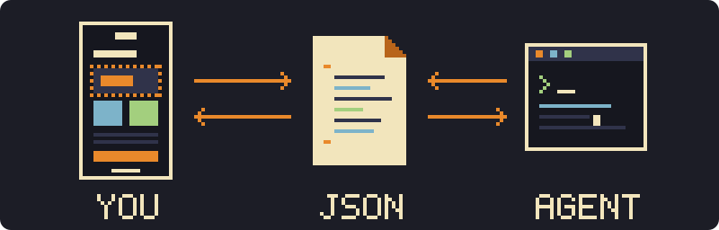
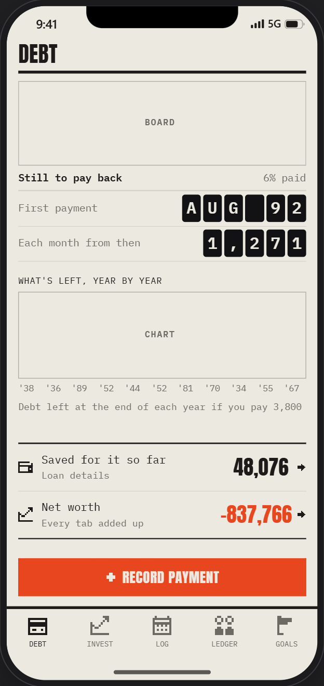
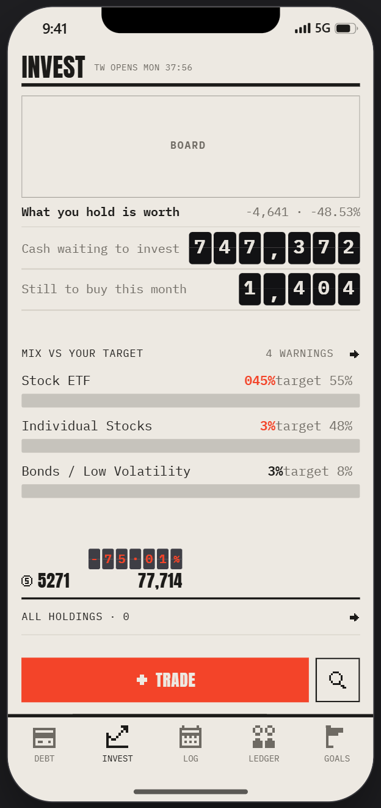
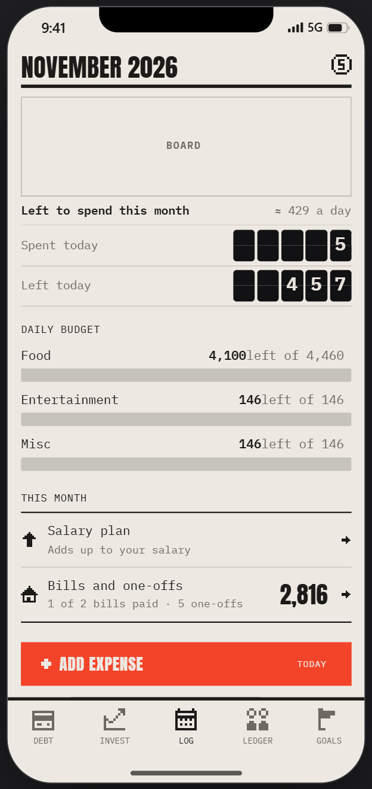
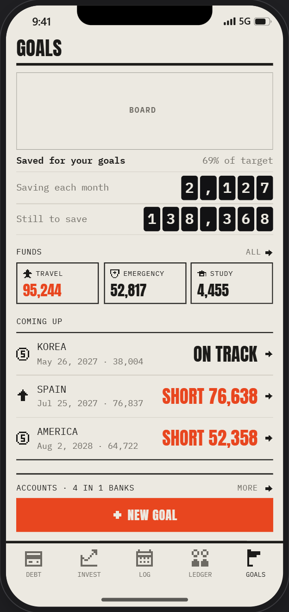
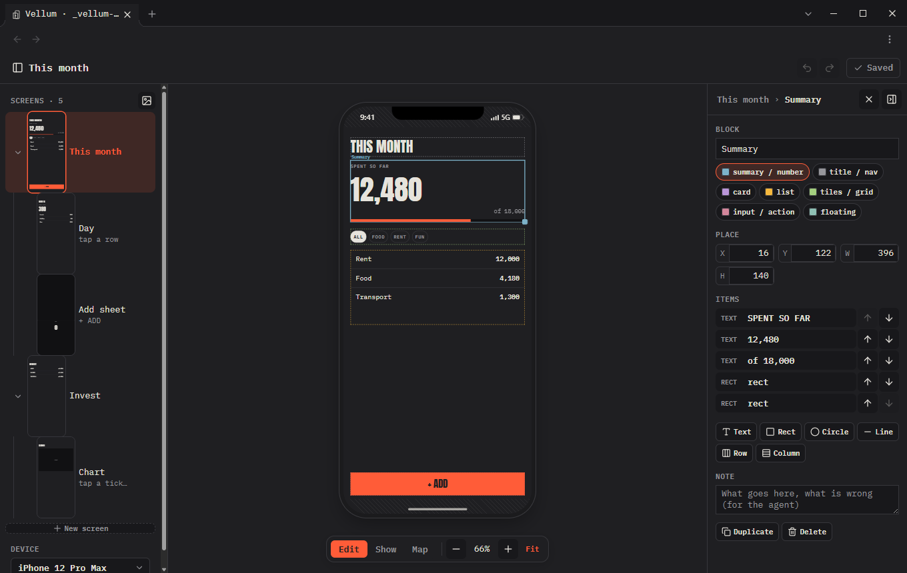
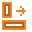
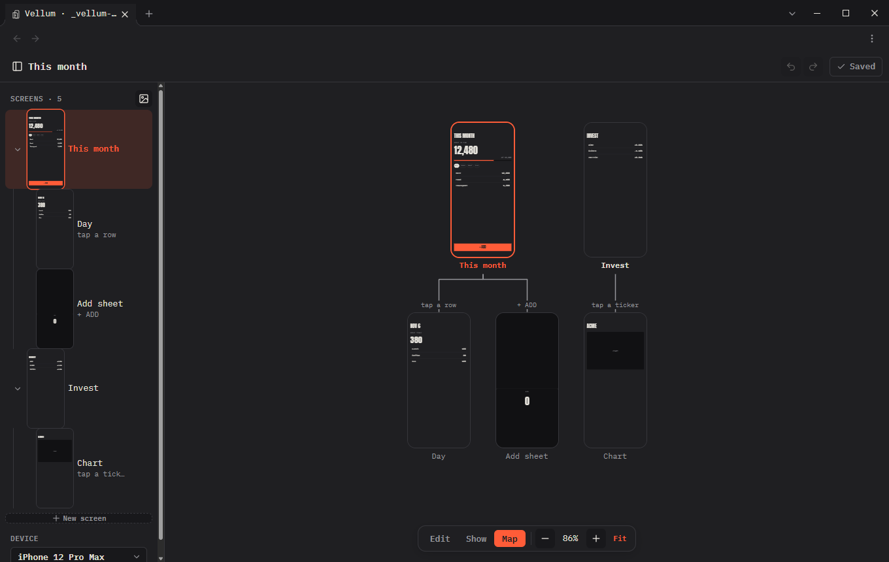
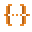
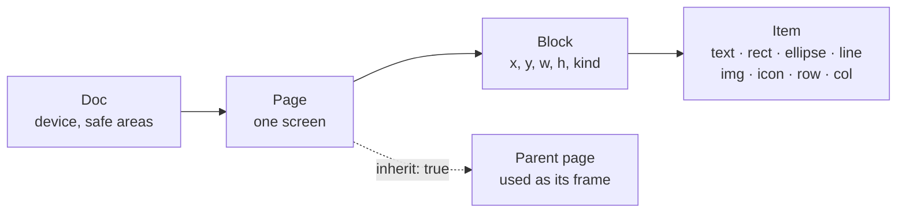

<h1 align="center">Vellum</h1>

<p align="center">
  <b>Mobile mockups for Obsidian plugins and vault apps, designed with your coding agent.</b>
</p>

<p align="center">
  <a href="https://github.com/zelvet-velvet/vellum/releases/latest"></a>
  <a href="https://obsidian.md"></a>
  <a href="LICENSE"></a>
</p>

<p align="center">
  
</p>

Sketch your plugin's screens on a real phone frame, inside your vault. Vellum keeps each screen as a small JSON file: your agent reads exactly where everything is and builds the plugin to match, with no screenshots and no long descriptions. Colours, fonts and icons come from your Obsidian theme, so the mockup already looks like the plugin.

<sub>The JSON is a layout intent, not native layout code. It maps directly to HTML and CSS, so to Obsidian plugins; for SwiftUI or Compose, see the [FAQ](#faq).</sub>

<p align="center">
  <a href="#install">Install</a> ·
  <a href="#quick-start">Quick start</a> ·
  <a href="#with-your-agent">With your agent</a> ·
  <a href="#file-format">File format</a> ·
  <a href="#faq">FAQ</a>
</p>

<table>
  <tr>
    <td width="25%"></td>
    <td width="25%"></td>
    <td width="25%"></td>
    <td width="25%"></td>
  </tr>
</table>

<p align="center"><sub>Screens of ZeLedger, a personal finance app built in Obsidian, designed in Vellum with Claude Code. Every number is made up.</sub></p>

<p align="center"></p>

##  Features

<table>
  <tr>
    <td width="33%" valign="top"><br><b>Real devices</b><br><sub>iPhone 12 – 17, Pixel 8, Galaxy S24 / S25, or any size, with cut-outs and safe areas.</sub></td>
    <td width="33%" valign="top"><br><b>Portrait and landscape</b><br><sub>A layout for each, one switch for the whole editor.</sub></td>
    <td width="33%" valign="top"><br><b>Blocks and gravity</b><br><sub>Text and shapes keep an anchor point, an offset, and hug / fixed / fill sizes.</sub></td>
  </tr>
  <tr>
    <td valign="top"><br><b>Pictures and icons</b><br><sub>Images by address or vault path; Lucide icons by name.</sub></td>
    <td valign="top"><br><b>Frames</b><br><sub>Screens share a layout and store only what they change.</sub></td>
    <td valign="top"><br><b>Snapping</b><br><sub>Edges, middles, margins and neighbours, with guide lines.</sub></td>
  </tr>
  <tr>
    <td valign="top"><br><b>Screen map</b><br><sub>Every screen as a tree, joined by how you get there.</sub></td>
    <td valign="top"><br><b>Its own window</b><br><sub>A full editor on a computer, a bottom sheet on a phone.</sub></td>
    <td valign="top"><br><b>Plain JSON</b><br><sub>One file per screen, one block per line. Small diffs.</sub></td>
  </tr>
</table>

<p align="center"><br><sub><b>Map</b>: every screen as a tree; mocks have a dashed outline</sub></p>

##  Install

- **Community plugins**: coming soon.
- **[BRAT](https://github.com/TfTHacker/obsidian42-brat)**: add the beta plugin `zelvet-velvet/vellum`.
- **Manual**: copy `main.js`, `manifest.json` and `styles.css` from the [latest release](https://github.com/zelvet-velvet/vellum/releases/latest) into `<vault>/.obsidian/plugins/vellum/`, then enable **Vellum**.

##  Quick start

1. Click **Vellum** in the ribbon. The editor opens on `Screens/`.
2. **New Screen**, add a block, place items in it.
3. **Ctrl+S** to save.

Want sample screens? Copy [`examples/Vellum Demo.md`](examples/Vellum%20Demo.md) into your vault.

##  With your agent

Any agent that reads and writes files works: Claude Code, Codex, Cursor. No plugin API, no server.

1. **The agent drafts** your app's screens, or proposes new ones.
2. **You adjust** them in the editor and leave a **Note** on what to change.
3. **The agent builds** from the screens you changed.

<table>
  <tr>
    <td width="36%" valign="top"></td>
    <td valign="top">

The card with the mix bars, as its file holds it:

```json
{"name": "Card 2", "kind": "card",
 "x": 16, "y": 397, "w": 396, "h": 182, "items": [
  {"type": "text", "v": "MIX VS YOUR TARGET", "size": 12},
  {"type": "text", "v": "4 WARNINGS", "dx": 286, "color": "dim"},
  {"type": "text", "v": "Stock ETF", "dy": 29, "size": 15},
  {"type": "rect", "dy": 54, "w": 396, "h": 16, "fill": "dim"}
]}
```

One screen is one small file. The agent reads exactly where each thing is, and changes only what it needs to.

</td>
  </tr>
</table>

```text
Read github.com/zelvet-velvet/vellum's README for the file format.
Write each page of my app as a Vellum screen in Design/Screens, one JSON file per screen.
Use real text, pictures by https address and icons by Lucide name. Keep ids stable.
Draw a card's background or outline with the block's own fill / stroke, and a chip or tile with the text's own box,
not with rectangles under them.
```

> [!TIP]
> Frames belong to what they frame: a block has its own `fill`, `stroke` and `sides`, a text its own box. A rectangle drawn as a frame (an older screen) shows **Make it the block's look** or **Make it the text's box** when you choose it.
>
> Ask for two or three **mocks** (`"mock": true`) as sub screens and keep the one you like. The agent can write while the editor is open: Vellum reloads the files and never overwrites your unsaved edits.

<sub>The screens of [Morellonomicon](https://github.com/zelvet-velvet/Morellonomicon) and ZeLedger were designed this way, with Claude Code.</sub>

##  File format



A folder holds one JSON file per screen, plus `_doc.json` for the device and the screen order. Show it in a note with:

````markdown
```vellum
src: Design/Screens
```
````

```json
{"id": "home", "name": "Home", "blocks": [
  {"id": "b1", "name": "Title", "kind": "nav", "x": 16, "y": 70, "w": 370, "h": 44, "items": [
    {"id": "t1", "type": "text", "v": "HOME", "font": "display", "size": 32, "g": "l"}]}]}
```

<details>
<summary><b>Field reference</b></summary>

| Level | Fields |
| :--- | :--- |
| **Doc** | `device`; `safe`, `safeLand` (`top bottom left right`, each optional) |
| **Page** | `name`, `note`, `parent`, `link` (how you get there), `inherit` (`true`: the parent is its frame), `device`, `bg`, `mock`, `blocks`, `land` (the landscape layout) |
| **Block** | `name`, `kind`, `note`, `x y w h` (screen points), `bleed` (`true`: may go into the safe areas), its own look: `fill stroke sw r` and `sides` (the outline on some sides only: `"b"`, `"tb"`…), `items` |
| **Any item** | `g` (anchor: `tl t tr l c r bl b br`), `dx dy`, `w h` (a number, `"hug"` or `"fill"`), `op`, `note` |
| `text` | `v size wt font color ls lh upper`, and a box of its own: `fill stroke sw r pad` (a chip, a tile, a button; with a set `h` the text sits in its middle) |
| `rect` `ellipse` `line` | `fill stroke sw r` (`r`: one radius, or four: `[tl, tr, br, bl]`) |
| `img` | `src` (`https://…` or a vault path), `fit` (`cover` · `contain` · `fill`), `pos` (CSS object-position), `r` |
| `icon` | `name` (Lucide), `color size sw` |
| `row` `col` | `items gap pad main cross`, `fill stroke sw r` |

**Frames.** A page with `"inherit": true` draws its parent's blocks under its own. An own block with the same `id` replaces the parent's one; the page stores only its own blocks.

**Colours and fonts.** Items use theme names (`paper text dim line tile loud accent`; `ui display mono`), set in Settings → Vellum, or any CSS value. The editor's own panels follow your Obsidian theme, or the Editor theme colours in the same settings.

</details>

##  Shortcuts

| | |
| :--- | :--- |
| <kbd>←</kbd> <kbd>→</kbd> <kbd>↑</kbd> <kbd>↓</kbd> | Nudge 1 pt, with <kbd>Shift</kbd> one grid step |
| <kbd>Ctrl</kbd> <kbd>Z</kbd> · <kbd>Ctrl</kbd> <kbd>Shift</kbd> <kbd>Z</kbd> | Undo · redo |
| <kbd>Ctrl</kbd> <kbd>D</kbd> · <kbd>Delete</kbd> | Duplicate · delete |
| <kbd>Ctrl</kbd> <kbd>S</kbd> · <kbd>Esc</kbd> | Save · go up a level |
| <kbd>Alt</kbd> / <kbd>Shift</kbd> while dragging | No snapping · keep the shape |
| Hold a number box, then drag up / down | Change it (the arrows beside it step it; Shift: ×10) |

##  FAQ

<details>
<summary><b>Does Vellum use the network?</b></summary>

Only to show a picture whose `src` is an `https://` address, as an image in a note would. Vellum makes no requests of its own.
</details>

<details>
<summary><b>Can I use it for a native iOS or Android app?</b></summary>

Yes, as a sketch your agent translates. Inside a block, items are placed the way native layouts work:

| Vellum | SwiftUI | Compose |
| :--- | :--- | :--- |
| anchor point (`g`) | `alignment` | `Alignment` |
| `"hug"` / `"fill"` | `.fixedSize()` / `.frame(maxWidth: .infinity)` | `wrapContentSize()` / `fillMaxWidth()` |
| `row` / `col` | `HStack` / `VStack` | `Row` / `Column` |

Blocks themselves sit at fixed positions on the screen, so the agent turns those into stacks and spacing.
</details>

<details>
<summary><b>Does it work on a phone?</b></summary>

Yes. The editor takes the full screen, with its settings in a bottom sheet.
</details>

<details>
<summary><b>Where is unsaved work kept?</b></summary>

On the device, in Obsidian's storage for that vault, until you save.
</details>

<details>
<summary><b>How do I build it?</b></summary>

```sh
npm install && npm run check && npm run build
npm run install-vault -- /path/to/vault
```
</details>

##  Support

Vellum is free and made in my spare time. If it helps you, a coffee keeps it going.

<a href="https://ko-fi.com/zelvet_velvet"></a>
