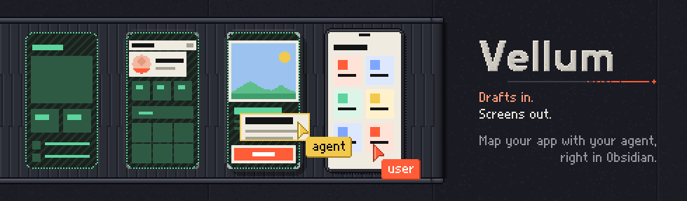
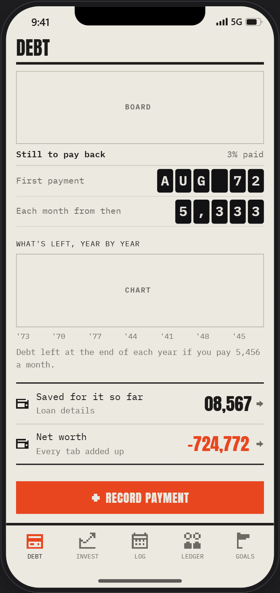
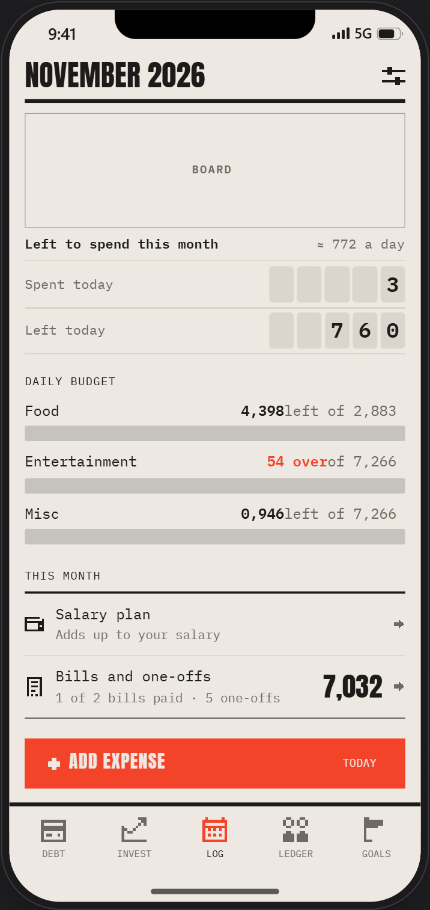
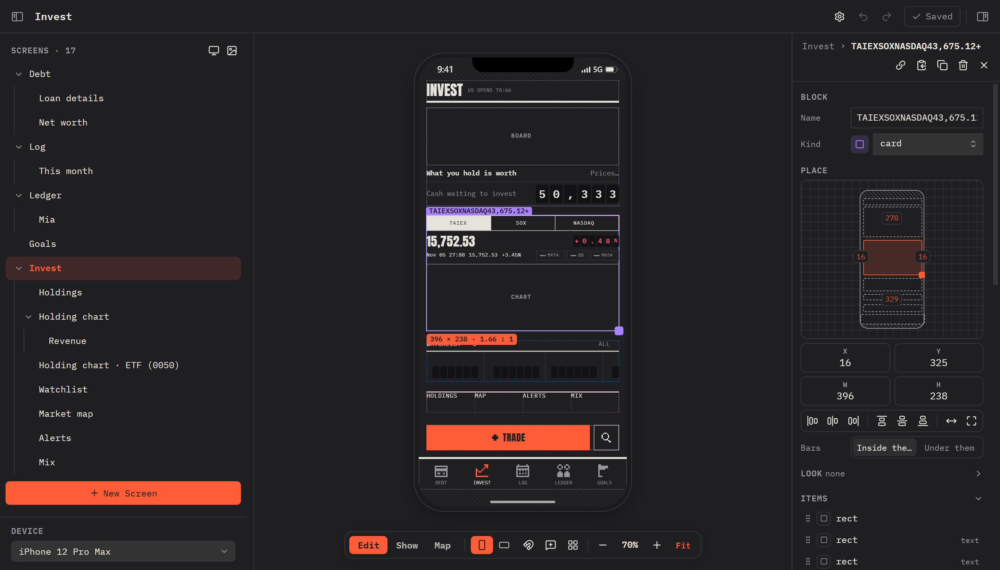
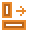
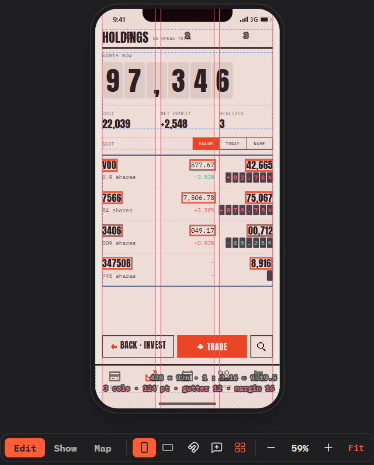
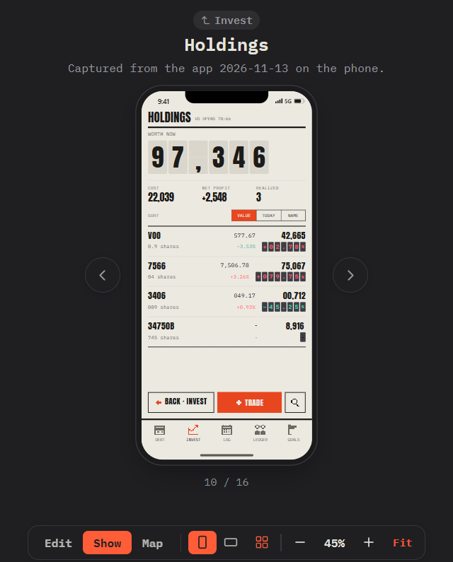
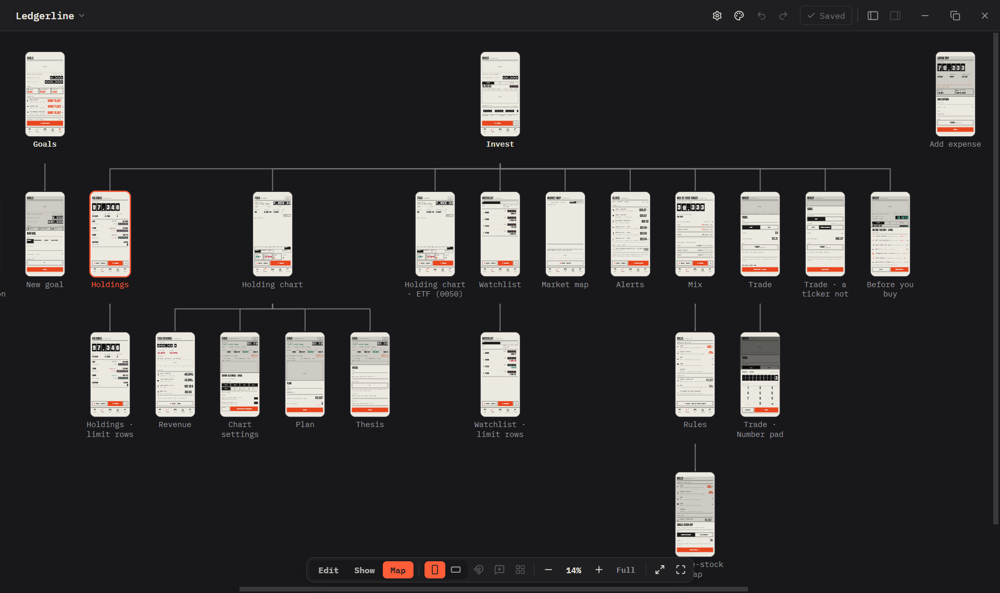
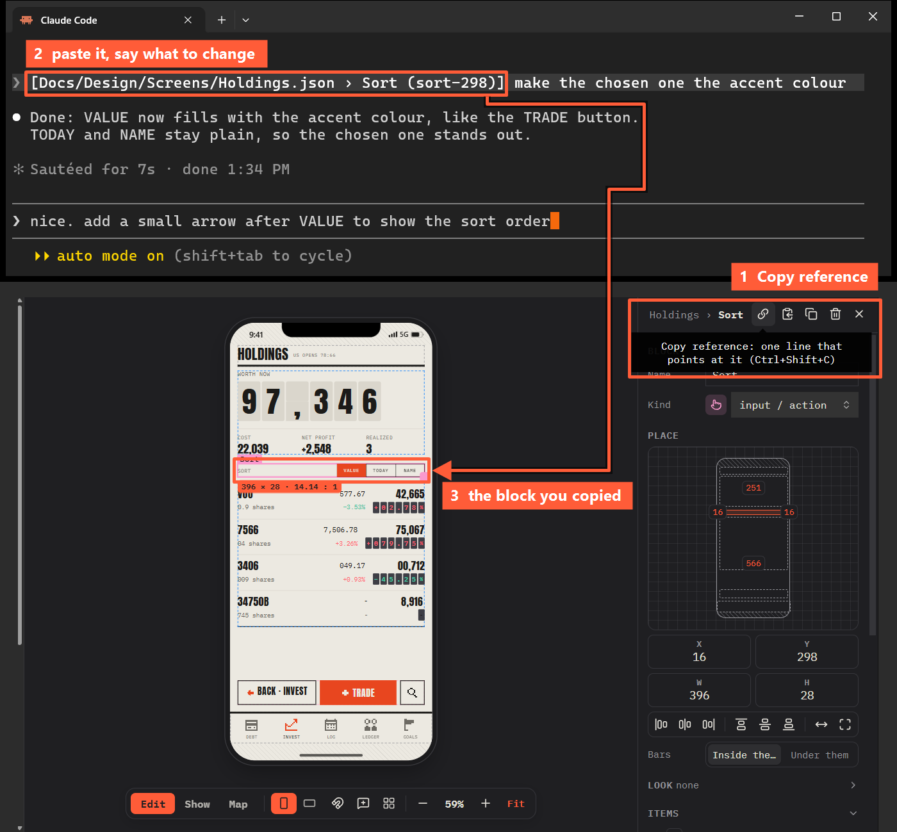
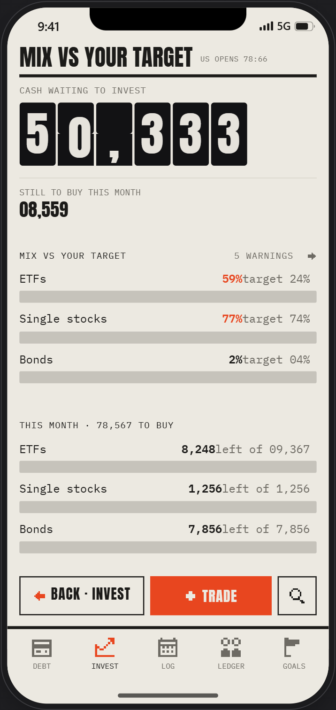

<h1 align="center">Vellum</h1>

<p align="center">
  <b>在 Obsidian 內繪製 app 畫面草稿，與 coding agent 協作。</b>
</p>

<p align="center">
  <a href="README.md">English</a> · <b>繁體中文</b>
</p>

<p align="center">
  <a href="https://github.com/zelvet-velvet/vellum/releases/latest"></a>
  <a href="https://obsidian.md"></a>
  <a href="LICENSE"></a>
</p>

<p align="center">
  
</p>

輕量外掛，UI 草稿全在儲存庫內完成，不需另開設計工具、網站或註冊帳號。以真實裝置外框排版（手機、平板、桌面視窗或任意尺寸），每個畫面存為一個 JSON 檔，可存取儲存庫的 agent 皆能得知每個元件的位置與尺寸，並修改同一份檔案。不需截圖或額外說明。

- **不限 app 類型與畫面尺寸**：手機 app、桌面視窗、網頁與 Obsidian 外掛皆可，個人專案或工作專案皆適用。同一儲存庫可放多個 app，各自一個資料夾與裝置設定。筆記在 Obsidian，畫面也能放在同一處
- **指定元件請 agent 修改**：一鍵複製 block 或 item 給 agent，說明要改的地方，於手機外框上確認結果
- **討論流程，而非只有排版**：Map 顯示畫面之間的連結，可與 agent 一起整理 app 的邏輯與 UX

顏色、字型與圖示依據 Obsidian 主題，外掛的排版結果與實際外觀一致。

<sub>JSON 描述的是排版意圖，不是原生版面程式碼。可直接對應 HTML 與 CSS，適用於 Obsidian 外掛；SwiftUI 與 Compose 的對應方式請參考[常見問題](#-常見問題)。</sub>

<p align="center">
  <a href="#-安裝">安裝</a> ·
  <a href="#-快速開始">快速開始</a> ·
  <a href="#-搭配-agent">搭配 agent</a> ·
  <a href="#-檔案格式">檔案格式</a> ·
  <a href="#-常見問題">常見問題</a>
</p>

<table>
  <tr>
    <td width="25%"></td>
    <td width="25%"></td>
    <td width="25%"></td>
    <td width="25%"></td>
  </tr>
</table>

<p align="center"><sub>Ledgerline 的畫面。Ledgerline 是以 Obsidian 實作的記帳 app，畫面由 Vellum 與 Claude Code 協作設計，數字皆為虛構。</sub></p>

<p align="center"></p>

##  功能

<table>
  <tr>
    <td width="33%" valign="top"><br><b>真實機型</b><br><sub>支援 iPhone 12 至 17、Pixel 8、Galaxy S24 / S25 與自訂尺寸（桌面視窗、平板、面板），包含瀏海、安全區域，並可自訂圓角與狀態列。</sub></td>
    <td width="33%" valign="top"><br><b>直向與橫向</b><br><sub>兩種方向各自排版，整個編輯器統一切換。</sub></td>
    <td width="33%" valign="top"><br><b>區塊與錨點</b><br><sub>文字與圖形保留錨點與位移，尺寸可設為 hug、固定或 fill。</sub></td>
  </tr>
  <tr>
    <td valign="top"><br><b>圖片與圖示</b><br><sub>圖片使用網址或儲存庫路徑，圖示使用 Lucide 名稱。</sub></td>
    <td valign="top"><br><b>共用版型</b><br><sub>多個畫面共用同一版型，各畫面僅儲存修改的部分。</sub></td>
    <td valign="top"><br><b>對齊吸附</b><br><sub>拖曳時對齊邊緣、中線、邊距與相鄰元件，並顯示參考線。</sub></td>
  </tr>
  <tr>
    <td valign="top"><br><b>畫面地圖</b><br><sub>所有畫面以樹狀顯示，並標示各畫面的進入方式。</sub></td>
    <td valign="top"><br><b>獨立視窗</b><br><sub>電腦上為完整編輯器，手機上設定收於底部面板。Show 模式可逐一預覽畫面。</sub></td>
    <td valign="top"><br><b>純 JSON</b><br><sub>一個畫面一個檔案，一個區塊一行，diff 簡潔。</sub></td>
  </tr>
  <tr>
    <td valign="top"><br><b>標註</b><br><sub>在畫面上加註記、命名區域與參考線，給你與 agent 溝通。</sub></td>
    <td valign="top"><br><b>輔助線</b><br><sub>格線、欄位、三分法、黃金比例與螺旋、消失點。</sub></td>
    <td valign="top"><br><b>框選與群組</b><br><sub>拖曳框選區塊或項目，一起移動，組成群組。</sub></td>
  </tr>
</table>

<table>
  <tr>
    <td width="50%" align="center"><br><sub><b>輔助線</b>：三欄格線，列表的名稱、價格與金額皆對齊欄位</sub></td>
    <td width="50%" align="center"><br><sub><b>Show</b>：預覽畫面，上方是進入的路徑，兩側切換畫面</sub></td>
  </tr>
</table>

<p align="center"><br><sub><b>地圖</b>：所有畫面以樹狀顯示並標示進入方式，點選即開啟</sub></p>

##  安裝

- **[社群外掛](https://obsidian.md/plugins?id=vellum)**：於 **設定 → 第三方外掛 → 瀏覽** 搜尋 **Vellum**，安裝後啟用
- **[BRAT](https://github.com/TfTHacker/obsidian42-brat)**：新增 beta 外掛 `zelvet-velvet/vellum`
- **手動安裝**：由[最新版本](https://github.com/zelvet-velvet/vellum/releases/latest)下載 `main.js`、`manifest.json` 與 `styles.css`，放入 `<儲存庫>/.obsidian/plugins/vellum/` 後啟用 **Vellum**

##  快速開始

1. 點選側邊欄的 **Vellum** 圖示，編輯器開啟 `Screens/` 資料夾
2. 點選 **New Screen** 新增畫面，新增區塊並放入元件
3. 按 **Ctrl+S** 存檔

範例畫面：將 [`examples/Vellum Demo.md`](examples/Vellum%20Demo.md) 複製至儲存庫。

##  搭配 agent

可讀寫檔案的 agent 皆可使用，例如 Claude Code、Codex 與 Cursor。不需外掛 API 或伺服器。

1. **agent 產生草稿**：依 app 現有頁面繪製畫面，或提出新畫面
2. **指定並提出修改**：選取 block 後按 **Copy reference**（<kbd>Ctrl</kbd> <kbd>Shift</kbd> <kbd>C</kbd>），貼給 agent 並說明要改的地方。或直接在畫面上加 **mark**：圖釘註記、命名的區域、參考線。agent 也能用 mark 回覆
3. **agent 實作**：依修改後的畫面實作

<p align="center"><br><sub><b>1</b> 對 block 按 Copy reference，<b>2</b> 貼給 agent 並說明要改的地方，<b>3</b> 檔案修改後手機畫面隨即更新。</sub></p>

<table>
  <tr>
    <td width="36%" valign="top"></td>
    <td valign="top">

比例條卡片於檔案中的內容：

```json
{"name": "Mix vs your target", "kind": "card",
 "x": 16, "y": 323, "w": 396, "h": 183, "items": [
  {"type": "text", "v": "MIX VS YOUR TARGET", "size": 12},
  {"type": "text", "v": "5 WARNINGS", "dx": 286, "color": "dim"},
  {"type": "text", "v": "ETFs", "dy": 29, "size": 15},
  {"type": "rect", "dy": 54, "w": 396, "h": 16, "fill": "dim"}
]}
```

一個畫面為一個小檔案，agent 可確認每個元件的位置，並僅修改需要修改的部分。

</td>
  </tr>
</table>

給 agent 的指示範例：

以下列內容開始；[給 agent 的說明](docs/for-agents.md)列出 Vellum 支援的功能：

```text
Read github.com/zelvet-velvet/vellum/blob/main/docs/for-agents.md.
將 app 的每一頁寫為 Vellum 畫面，存於 Vellum/<app 名稱>，完成後告訴我資料夾位置。
需要多個方案時，以 Vellum 的 mock 製作，不要做成網頁。
```

Vellum 亦內建此說明，agent 無須連結即可讀取。說明為 `VELLUM.md`，置於存放各 app 的資料夾中，每個 app 為其旁的子資料夾（`Vellum/VELLUM.md`、`Vellum/Remote/`、`Vellum/Console/`）。於尚無說明的資料夾新建 app 時，Vellum 會自動寫入；既有的 app 請執行 **Vellum: Add the agent guide**。於自己的 `AGENTS.md` 或 `CLAUDE.md` 加一行指向此檔即可。Claude Code 可執行 **Add the agent guide as a Claude Code skill**（寫入 `.claude/skills/vellum/`），會自動載入。內容與目前安裝的 Vellum 版本一致，Vellum 更新時會一併重寫；自行撰寫的 `VELLUM.md` 不會被覆寫。

> [!TIP]
> 外框屬於被框住的元件：區塊有自己的 `fill`、`stroke` 與 `sides`，文字也有自己的外框。舊畫面中以矩形當外框的，選取時會顯示 **Make it the block's look** 或 **Make it the text's box** 以轉換。
>
> 可請 agent 產生兩到三個 **mock**（`"mock": true`）作為子畫面，再保留選定的版本。編輯器開啟時 agent 仍可寫入檔案，Vellum 會重新載入，且不會覆蓋尚未儲存的修改。

<sub>[Morellonomicon](https://github.com/zelvet-velvet/Morellonomicon) 與 Ledgerline 的畫面皆以此方式與 Claude Code 協作設計。</sub>

##  檔案格式

每個 app 一個資料夾，每個畫面一個小檔案，各 app 與 agent 說明並列：

```text
Vellum/
├─ VELLUM.md          給 agent 的說明
└─ Remote/            一個 app
   ├─ _doc.json       裝置：尺寸、安全區域、圓角、狀態列；App 的顏色；畫面順序
   ├─ Home.json       一個畫面
   └─ Settings.json   另一個畫面
```

畫面由數個 **block** 組成，即手機上的方框。每個 block 內放 **item**，依錨點定位：

```jsonc
{"id": "home", "name": "Home", "blocks": [
  {"id": "title", "name": "Title", "kind": "nav", "x": 16, "y": 70, "w": 396, "h": 44,    // 方框，單位為 pt
   "items": [
     {"id": "t1", "type": "text", "v": "HOME", "font": "display", "size": 32, "g": "l"},  // 靠左、垂直置中
     {"id": "i1", "type": "icon", "name": "settings", "g": "r"}                          // 靠右：Lucide 圖示
   ]}
]}
```

於筆記中以 `vellum` 程式碼區塊加上 `src: Vellum/Remote` 顯示畫面。所有欄位列於下方；agent 另有[專用說明](docs/for-agents.md)。

<details>
<summary><b>欄位說明</b></summary>

| 層級 | 欄位 |
| :--- | :--- |
| **Doc** | `device`（手機的 id，或自訂尺寸 `custom-<w>x<h>`，結尾加 `-tablet`、`-window` 或 `-web` 表示平板、視窗或網頁：視窗與網頁為直角，無狀態列與安全區域）；`safe`、`safeLand`（`top bottom left right`，皆可省略）；`radius`（螢幕圓角，`0` 為直角；省略則用裝置的）；`bar`（狀態列：`style` 為 `ios`、`android` 或 `none`，`fill`、`ink`、`time`；設了 `safe.top` 時高度與其相同）；`colors`（此 App 自己的具名顏色，蓋過設定）；`themes`（具名色盤，蓋在其上，如 `light`、`dark`）與 `theme`（開啟時使用的色盤，或 `auto`：隨 Obsidian 的淺色或深色；省略則用 Obsidian 的顏色） |
| **Page** | `name`、`note`、`parent`、`link`（進入方式）、`inherit`（`true`：以上層畫面為版型）、`device`、`bg`、`mock`、`blocks`、`land`（橫向排版）、`marks` |
| **Block** | `name`、`kind`、`note`、`x y w h`（螢幕 pt）、`bleed`（`true`：可延伸至安全區域；整個在螢幕外的 block 為**草稿**，只在編輯器中顯示於螢幕旁，不實作）、本身外觀：`fill stroke sw r` 與 `sides`（僅部分邊的外框：`"b"`、`"tb"`…）、`lock`（`true`：照常繪製，但在螢幕上點擊會穿透至下層；由 Blocks 清單選取）、`items` |
| **所有 item** | `g`（錨點：`tl t tr l c r bl b br`）、`dx dy`、`w h`（數字、`"hug"` 或 `"fill"`）、`op`、`note`、`lock`（同 block） |
| `text` | `v size wt font color ls lh upper`，以及本身外框：`fill stroke sw r pad`（標籤、磚塊、按鈕；設定 `h` 時文字垂直置中） |
| `rect` `ellipse` `line` | `fill stroke sw r`（`r`：單一半徑，或四個：`[tl, tr, br, bl]`） |
| `img` | `src`（`https://…` 或儲存庫路徑）、`fit`（`cover` · `contain` · `fill`）、`pos`（CSS object-position）、`r` |
| `icon` | `name`（Lucide）、`color size sw` |
| `row` `col` | `items gap pad main cross`、`fill stroke sw r` |
| `group` | `items`，各自以自己的 `g dx dy` 放在群組的 `w h` 範圍內；整組一起移動 |
| **Mark** | 畫面上給你與 agent 的標註，不屬於設計本身：`id`、`kind`（`note`：圖釘 · `area`：`w h` 的框，可加 `guide`：`thirds phi spiral diag center` · `line`：`axis` `"x"` 直線或 `"y"` 橫線）、`x y`、`text`、`color`、`size`（文字大小，省略為 11）、note 的 `w`（說明框寬度，省略則依文字寬度）、`land`、`by`（`"agent"`） |

**版型。** `"inherit": true` 的畫面會先顯示上層畫面的區塊，再疊加本身的區塊。本身區塊與上層區塊 `id` 相同時取代上層區塊；畫面僅儲存本身的區塊。

**顏色與字型。** item 使用主題名稱（`paper text dim line tile loud accent`；`ui display mono`），於「設定 → Vellum」設定，或使用任何 CSS 值。App 可在自己的 `_doc.json` 設定顏色與主題（淺色、深色或任何名稱）。可在「設定 → Vellum → Screen colours」選擇該 App 後設定，或在編輯器的 Colours 視窗（頂列的調色盤按鈕）設定，並在其中切換主題檢查每個畫面。編輯器面板依據 Obsidian 主題，或使用同一頁的 Editor theme 顏色。

</details>

##  快捷鍵

| | |
| :--- | :--- |
| <kbd>←</kbd> <kbd>→</kbd> <kbd>↑</kbd> <kbd>↓</kbd> | 移動 1 pt，按住 <kbd>Shift</kbd> 移動一格 |
| <kbd>Ctrl</kbd> <kbd>Z</kbd> · <kbd>Ctrl</kbd> <kbd>Shift</kbd> <kbd>Z</kbd> | 復原 · 重做 |
| <kbd>Ctrl</kbd> <kbd>D</kbd> · <kbd>Delete</kbd> | 複製 · 刪除 |
| <kbd>Ctrl</kbd> <kbd>S</kbd> | 存檔 |
| 拖曳時按住 <kbd>Alt</kbd> / <kbd>Shift</kbd> | 不吸附 · 維持比例 |
| 按住滑鼠中鍵拖曳 · <kbd>Ctrl</kbd> + 滾輪 | 移動視野 · 以游標為中心縮放（最大 1600 %） |
| 在空白處拖曳 · 按住 <kbd>Ctrl</kbd> | 選取框內的區塊（或框到的項目）· 一律選項目 |
| <kbd>Shift</kbd> 點選 · <kbd>Ctrl</kbd> <kbd>A</kbd> | 加入或移出選取 · 全部區塊 |
| <kbd>Ctrl</kbd> <kbd>G</kbd> · <kbd>Ctrl</kbd> <kbd>Shift</kbd> <kbd>G</kbd> | 將選取的項目組成群組 · 解散群組、列或欄（項目留在原位） |
| <kbd>N</kbd> · <kbd>Shift</kbd> <kbd>N</kbd> | 標註工具（點一下：註記，拖曳：區域）· 顯示 / 隱藏標註 |
| <kbd>Ctrl</kbd> <kbd>'</kbd> | 顯示 / 隱藏輔助線 |
| <kbd>Ctrl</kbd> <kbd>Shift</kbd> <kbd>C</kbd> | 複製所選畫面、block 或 item 的參照，供 agent 使用 |
| Show 模式下 <kbd>←</kbd> <kbd>→</kbd> | 上一個 · 下一個畫面 |
| 按住數字框並上下拖曳 | 調整數值（點選可輸入；<kbd>↑</kbd> <kbd>↓</kbd> 調整一步，按住 <kbd>Shift</kbd> 調整十步） |

##  常見問題

<details>
<summary><b>Vellum 是否使用網路？</b></summary>

僅在顯示 `src` 為 `https://` 網址的圖片時使用，與筆記中的網路圖片相同。Vellum 本身不發出任何請求。
</details>

<details>
<summary><b>可否用於原生 iOS 或 Android app？</b></summary>

可以，作為草稿由 agent 轉換。區塊內元件的排版方式與原生版面對應：

| Vellum | SwiftUI | Compose |
| :--- | :--- | :--- |
| 錨點（`g`） | `alignment` | `Alignment` |
| `"hug"` / `"fill"` | `.fixedSize()` / `.frame(maxWidth: .infinity)` | `wrapContentSize()` / `fillMaxWidth()` |
| `row` / `col` | `HStack` / `VStack` | `Row` / `Column` |

區塊本身於畫面上為固定位置，由 agent 轉換為 stack 與間距。
</details>

<details>
<summary><b>可否用於桌面 app 或網頁？</b></summary>

可以。將資料夾設為視窗本身的自訂尺寸並選「視窗」（`"device": "custom-1280x800-window"`，或 Device → Custom → Window），即為無圓角、無狀態列與安全區域的矩形。單一畫面可另設尺寸，用於對話框或較小的視窗。每個 app 各自一個資料夾，手機 app 與其桌面端可並存於同一儲存庫。
</details>

<details>
<summary><b>手機上可否使用？</b></summary>

可以。編輯器以全螢幕顯示，設定收於底部面板。
</details>

<details>
<summary><b>尚未儲存的修改存放於何處？</b></summary>

存放於本機 Obsidian 該儲存庫的空間，直到存檔為止。
</details>

<details>
<summary><b>如何自行 build？</b></summary>

```sh
npm install && npm run check && npm run build
npm run install-vault -- /path/to/vault
```
</details>

##  贊助

Vellum 為免費軟體，利用空閒時間開發。如果對你有幫助，歡迎請我喝杯咖啡支持後續開發。

<a href="https://ko-fi.com/zelvet_velvet"></a>
