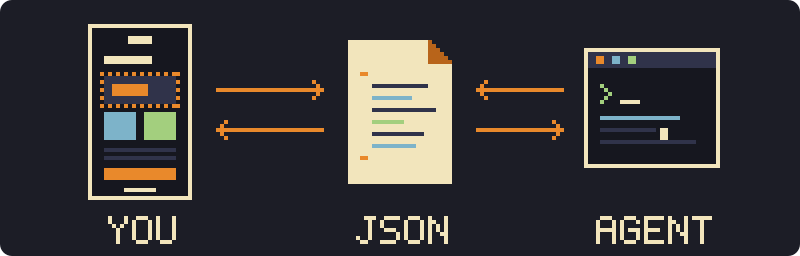
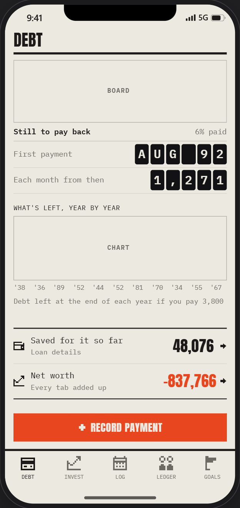
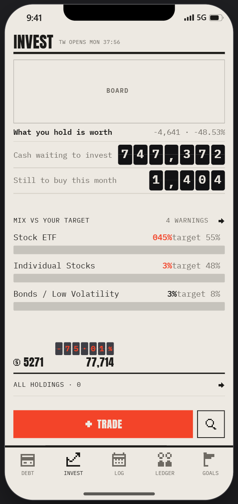
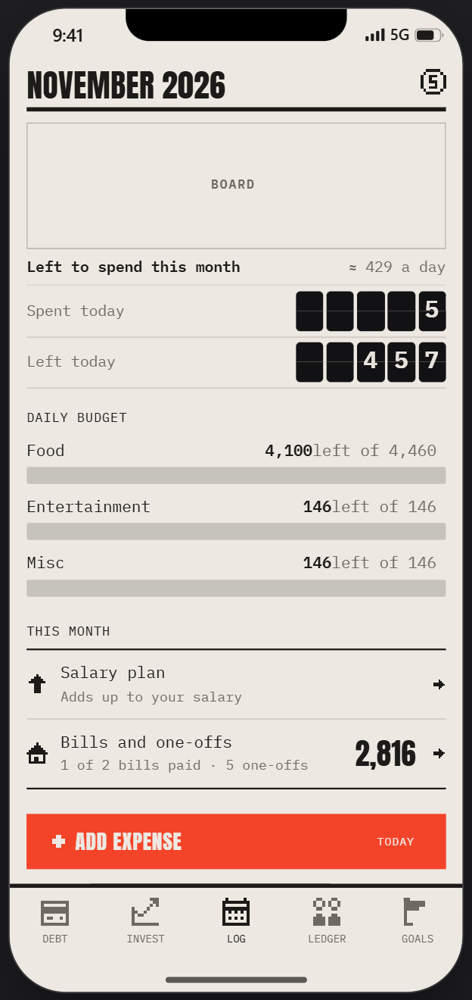
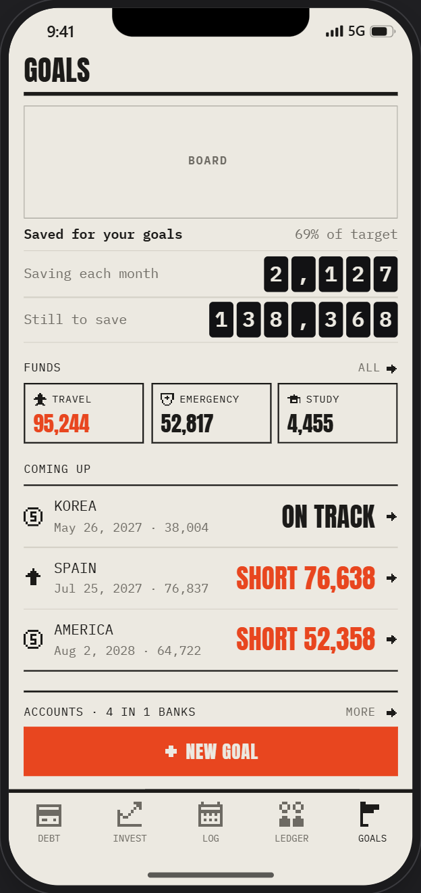
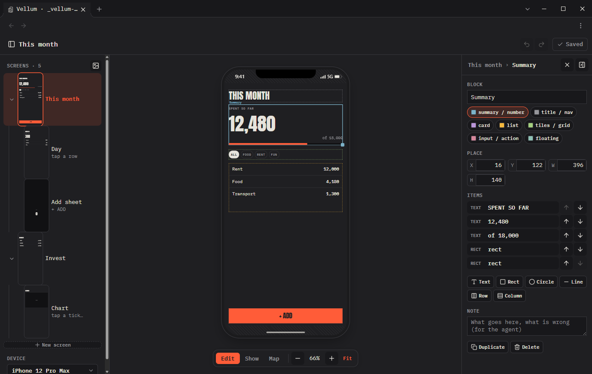
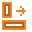
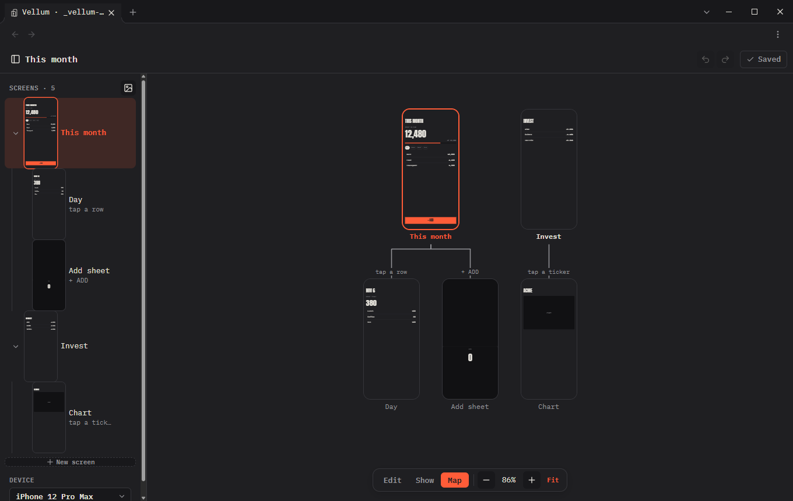
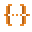
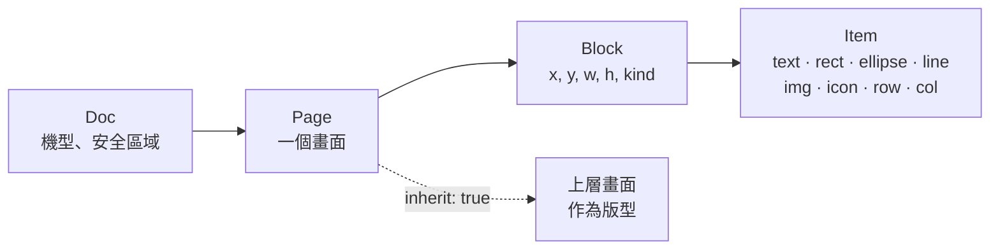

<h1 align="center">Vellum</h1>

<p align="center">
  <b>在 Obsidian 裡編輯手機排版，再與你的 coding agent 協作。</b>
</p>

<p align="center">
  <a href="README.md">English</a> · <b>繁體中文</b>
</p>

<p align="center">
  <a href="https://github.com/zelvet-velvet/vellum/releases/latest"></a>
  <a href="https://obsidian.md"></a>
  <a href="LICENSE"></a>
</p>

<p align="center">
  
</p>

於儲存庫內，以真實手機外框編輯外掛的畫面排版。每個畫面存為一個 JSON 檔，agent 可依檔案得知每個元件的位置與尺寸並據此實作外掛，不需截圖或額外說明。顏色、字型與圖示依據 Obsidian 主題，排版結果與外掛實際外觀一致。

<sub>JSON 描述的是排版意圖，不是原生版面程式碼。可直接對應 HTML 與 CSS，適用於 Obsidian 外掛；SwiftUI 與 Compose 的對應方式請參考[常見問題](#-常見問題)。</sub>

<p align="center">
  <a href="#-安裝">安裝</a> ·
  <a href="#-快速開始">快速開始</a> ·
  <a href="#-搭配-agent">搭配 agent</a> ·
  <a href="#-檔案格式">檔案格式</a> ·
  <a href="#-常見問題">常見問題</a>
</p>

<table>
  <tr>
    <td width="25%"></td>
    <td width="25%"></td>
    <td width="25%"></td>
    <td width="25%"></td>
  </tr>
</table>

<p align="center"><sub>ZeLedger 的畫面。ZeLedger 是以 Obsidian 實作的記帳 app，畫面由 Vellum 與 Claude Code 協作設計，數字皆為虛構。</sub></p>

<p align="center"></p>

##  功能

<table>
  <tr>
    <td width="33%" valign="top"><br><b>真實機型</b><br><sub>支援 iPhone 12 至 17、Pixel 8、Galaxy S24 / S25 與自訂尺寸，包含瀏海與安全區域。</sub></td>
    <td width="33%" valign="top"><br><b>直向與橫向</b><br><sub>兩種方向各自排版，整個編輯器統一切換。</sub></td>
    <td width="33%" valign="top"><br><b>區塊與錨點</b><br><sub>文字與圖形保留錨點與位移，尺寸可設為 hug、固定或 fill。</sub></td>
  </tr>
  <tr>
    <td valign="top"><br><b>圖片與圖示</b><br><sub>圖片使用網址或儲存庫路徑，圖示使用 Lucide 名稱。</sub></td>
    <td valign="top"><br><b>共用版型</b><br><sub>多個畫面共用同一版型，各畫面僅儲存修改的部分。</sub></td>
    <td valign="top"><br><b>對齊吸附</b><br><sub>拖曳時對齊邊緣、中線、邊距與相鄰元件，並顯示參考線。</sub></td>
  </tr>
  <tr>
    <td valign="top"><br><b>畫面地圖</b><br><sub>所有畫面以樹狀顯示，並標示各畫面的進入方式。</sub></td>
    <td valign="top"><br><b>獨立視窗</b><br><sub>電腦上為完整編輯器，手機上設定收於底部面板。</sub></td>
    <td valign="top"><br><b>純 JSON</b><br><sub>一個畫面一個檔案，一個區塊一行，diff 簡潔。</sub></td>
  </tr>
</table>

<p align="center"><br><sub><b>地圖</b>：所有畫面以樹狀顯示，mock 以虛線外框標示</sub></p>

##  安裝

- **[BRAT](https://github.com/TfTHacker/obsidian42-brat)**：新增 beta 外掛 `zelvet-velvet/vellum`
- **手動安裝**：由[最新版本](https://github.com/zelvet-velvet/vellum/releases/latest)下載 `main.js`、`manifest.json` 與 `styles.css`，放入 `<儲存庫>/.obsidian/plugins/vellum/` 後啟用 **Vellum**

##  快速開始

1. 點選側邊欄的 **Vellum** 圖示，編輯器開啟 `Screens/` 資料夾
2. 點選 **New Screen** 新增畫面，新增區塊並放入元件
3. 按 **Ctrl+S** 存檔

範例畫面：將 [`examples/Vellum Demo.md`](examples/Vellum%20Demo.md) 複製至儲存庫。

##  搭配 agent

可讀寫檔案的 agent 皆可使用，例如 Claude Code、Codex 與 Cursor。不需外掛 API 或伺服器。

1. **agent 產生草稿**：依 app 現有頁面繪製畫面，或提出新畫面
2. **於編輯器調整**：修改畫面，並於 **Note** 註記需要修改的地方
3. **agent 實作**：依修改後的畫面實作

<table>
  <tr>
    <td width="36%" valign="top"></td>
    <td valign="top">

比例條卡片於檔案中的內容：

```json
{"name": "Card 2", "kind": "card",
 "x": 16, "y": 397, "w": 396, "h": 182, "items": [
  {"type": "text", "v": "MIX VS YOUR TARGET", "size": 12},
  {"type": "text", "v": "4 WARNINGS", "dx": 286, "color": "dim"},
  {"type": "text", "v": "Stock ETF", "dy": 29, "size": 15},
  {"type": "rect", "dy": 54, "w": 396, "h": 16, "fill": "dim"}
]}
```

一個畫面為一個小檔案，agent 可確認每個元件的位置，並僅修改需要修改的部分。

</td>
  </tr>
</table>

給 agent 的指示範例：

```text
依據 github.com/zelvet-velvet/vellum 的 README 確認檔案格式。
將 app 的每一頁寫為 Vellum 畫面，存於 Design/Screens，一個畫面一個 JSON 檔。
文字使用實際內容，圖片使用 https 網址，圖示使用 Lucide 名稱，id 保持不變。
卡片底色與外框使用區塊本身的 fill / stroke，標籤與磚塊使用文字本身的外框，
不在下方另外疊加矩形。
```

> [!TIP]
> 外框屬於被框住的元件：區塊有自己的 `fill`、`stroke` 與 `sides`，文字也有自己的外框。舊畫面中以矩形當外框的，選取時會顯示 **Make it the block's look** 或 **Make it the text's box** 以轉換。
>
> 可請 agent 產生兩到三個 **mock**（`"mock": true`）作為子畫面，再保留選定的版本。編輯器開啟時 agent 仍可寫入檔案，Vellum 會重新載入，且不會覆蓋尚未儲存的修改。

<sub>[Morellonomicon](https://github.com/zelvet-velvet/Morellonomicon) 與 ZeLedger 的畫面皆以此方式與 Claude Code 協作設計。</sub>

##  檔案格式



一個資料夾內每個畫面一個 JSON 檔，另以 `_doc.json` 記錄機型與畫面順序。於筆記中顯示：

````markdown
```vellum
src: Design/Screens
```
````

```json
{"id": "home", "name": "Home", "blocks": [
  {"id": "b1", "name": "Title", "kind": "nav", "x": 16, "y": 70, "w": 370, "h": 44, "items": [
    {"id": "t1", "type": "text", "v": "HOME", "font": "display", "size": 32, "g": "l"}]}]}
```

<details>
<summary><b>欄位說明</b></summary>

| 層級 | 欄位 |
| :--- | :--- |
| **Doc** | `device`；`safe`、`safeLand`（`top bottom left right`，皆可省略） |
| **Page** | `name`、`note`、`parent`、`link`（進入方式）、`inherit`（`true`：以上層畫面為版型）、`device`、`bg`、`mock`、`blocks`、`land`（橫向排版） |
| **Block** | `name`、`kind`、`note`、`x y w h`（螢幕 pt）、`bleed`（`true`：可延伸至安全區域）、本身外觀：`fill stroke sw r` 與 `sides`（僅部分邊的外框：`"b"`、`"tb"`…）、`items` |
| **所有 item** | `g`（錨點：`tl t tr l c r bl b br`）、`dx dy`、`w h`（數字、`"hug"` 或 `"fill"`）、`op`、`note` |
| `text` | `v size wt font color ls lh upper`，以及本身外框：`fill stroke sw r pad`（標籤、磚塊、按鈕；設定 `h` 時文字垂直置中） |
| `rect` `ellipse` `line` | `fill stroke sw r`（`r`：單一半徑，或四個：`[tl, tr, br, bl]`） |
| `img` | `src`（`https://…` 或儲存庫路徑）、`fit`（`cover` · `contain` · `fill`）、`pos`（CSS object-position）、`r` |
| `icon` | `name`（Lucide）、`color size sw` |
| `row` `col` | `items gap pad main cross`、`fill stroke sw r` |

**版型。** `"inherit": true` 的畫面會先顯示上層畫面的區塊，再疊加本身的區塊。本身區塊與上層區塊 `id` 相同時取代上層區塊；畫面僅儲存本身的區塊。

**顏色與字型。** item 使用主題名稱（`paper text dim line tile loud accent`；`ui display mono`），於「設定 → Vellum」設定，或使用任何 CSS 值。編輯器面板依據 Obsidian 主題，或使用同一頁的 Editor theme 顏色。

</details>

##  快捷鍵

| | |
| :--- | :--- |
| <kbd>←</kbd> <kbd>→</kbd> <kbd>↑</kbd> <kbd>↓</kbd> | 移動 1 pt，按住 <kbd>Shift</kbd> 移動一格 |
| <kbd>Ctrl</kbd> <kbd>Z</kbd> · <kbd>Ctrl</kbd> <kbd>Shift</kbd> <kbd>Z</kbd> | 復原 · 重做 |
| <kbd>Ctrl</kbd> <kbd>D</kbd> · <kbd>Delete</kbd> | 複製 · 刪除 |
| <kbd>Ctrl</kbd> <kbd>S</kbd> | 存檔 |
| 拖曳時按住 <kbd>Alt</kbd> / <kbd>Shift</kbd> | 不吸附 · 維持比例 |
| 按住數字框並上下拖曳 | 調整數值（點選可輸入；<kbd>↑</kbd> <kbd>↓</kbd> 調整一步，按住 <kbd>Shift</kbd> 調整十步） |

##  常見問題

<details>
<summary><b>Vellum 是否使用網路？</b></summary>

僅在顯示 `src` 為 `https://` 網址的圖片時使用，與筆記中的網路圖片相同。Vellum 本身不發出任何請求。
</details>

<details>
<summary><b>可否用於原生 iOS 或 Android app？</b></summary>

可以，作為草稿由 agent 轉換。區塊內元件的排版方式與原生版面對應：

| Vellum | SwiftUI | Compose |
| :--- | :--- | :--- |
| 錨點（`g`） | `alignment` | `Alignment` |
| `"hug"` / `"fill"` | `.fixedSize()` / `.frame(maxWidth: .infinity)` | `wrapContentSize()` / `fillMaxWidth()` |
| `row` / `col` | `HStack` / `VStack` | `Row` / `Column` |

區塊本身於畫面上為固定位置，由 agent 轉換為 stack 與間距。
</details>

<details>
<summary><b>手機上可否使用？</b></summary>

可以。編輯器以全螢幕顯示，設定收於底部面板。
</details>

<details>
<summary><b>尚未儲存的修改存放於何處？</b></summary>

存放於本機 Obsidian 該儲存庫的空間，直到存檔為止。
</details>

<details>
<summary><b>如何自行 build？</b></summary>

```sh
npm install && npm run check && npm run build
npm run install-vault -- /path/to/vault
```
</details>

##  贊助

Vellum 為免費軟體，利用空閒時間開發。如果對你有幫助，歡迎請我喝杯咖啡支持後續開發。

<a href="https://ko-fi.com/zelvet_velvet"></a>
