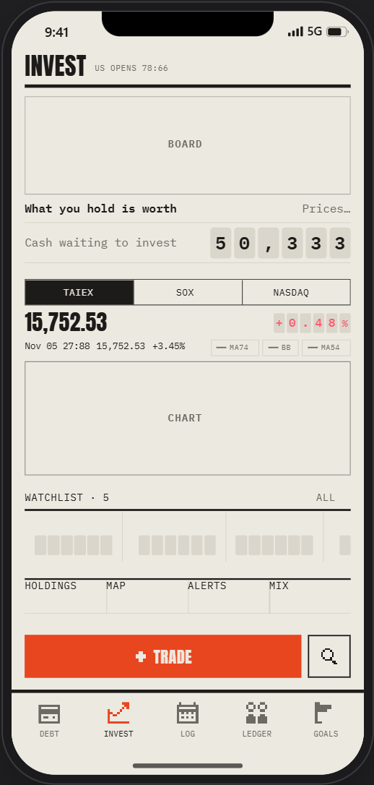
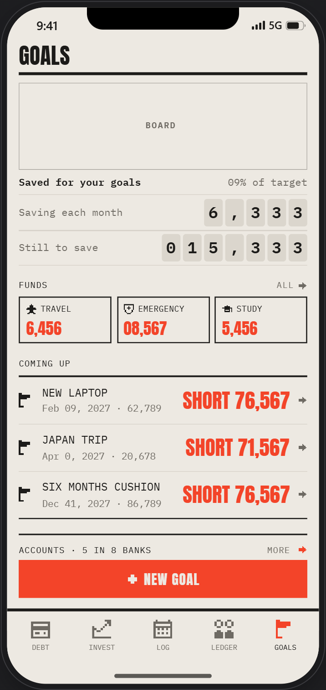
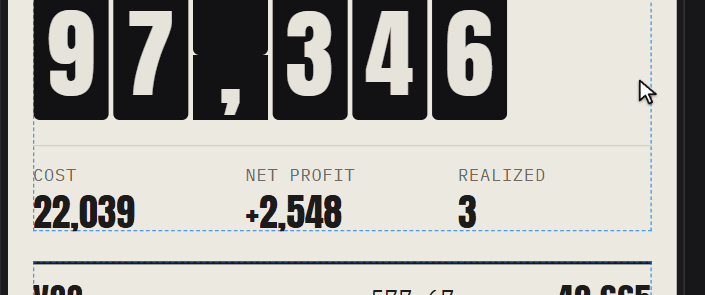
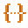

<h1 align="center">Vellum</h1>

<p align="center">
  <b>在 Obsidian 內繪製 app 畫面草稿，與 coding agent 協作。</b>
</p>

<p align="center">
  <a href="README.md">English</a> · <b>繁體中文</b>
</p>

<p align="center">
  <a href="https://github.com/zelvet-velvet/vellum/releases/latest"></a>
  <a href="https://obsidian.md"></a>
  <a href="LICENSE"></a>
</p>

<p align="center">
  
</p>

<p align="center"></p>

<p align="center">
  <a href="#-安裝">安裝</a> ·
  <a href="#-快速開始">快速開始</a> ·
  <a href="#-搭配-agent">搭配 agent</a> ·
  <a href="#-檔案格式">檔案格式</a> ·
  <a href="#-快捷鍵">快捷鍵</a> ·
  <a href="#-常見問題">常見問題</a>
</p>

於儲存庫內以真實裝置外框排版 app 畫面，不需另開設計工具、網站或註冊帳號。每個畫面存為一個小型 JSON 檔，agent 可得知每個元件的位置，並與你修改同一批檔案。

- **不限 app 類型**：手機 app、桌面視窗、網頁與 Obsidian 外掛皆可。同一儲存庫可放多個 app，各自一個資料夾
- **指定元件提出修改**：一鍵複製 block 給 agent，說明要改的地方，於手機外框上確認結果
- **完整流程**：Map 顯示畫面之間的連結，可與 agent 一起整理 app 的邏輯，而非只有排版

<table>
  <tr>
    <td width="25%"></td>
    <td width="25%"></td>
    <td width="25%"></td>
    <td width="25%"></td>
  </tr>
</table>

<p align="center"><sub>Ledgerline 的畫面。Ledgerline 是以 Obsidian 實作的記帳 app，畫面由 Vellum 與 Claude Code 協作設計，數字皆為虛構。</sub></p>

##  為何不用 artifact 或 canvas？

Claude artifact 與 ChatGPT、Gemini 的 canvas 也能畫出 mockup。Vellum 處理的是之後的部分：修改、保存，並與 agent 一起依畫面實作。

| | artifact 或 canvas | Vellum |
| :--- | :--- | :--- |
| **修改一處** | 重新要求，或編輯 HTML | 直接拖曳、調整樣式、輸入數值 |
| **存放位置** | 對話中 | 儲存庫或專案中，每個畫面一個小檔案，可用 git 管理 |
| **agent 讀回的內容** | 自己的程式碼，不含你的手動修改 | 你留下的檔案：每個區塊、位置與尺寸 |
| **整個 app** | 一次一頁 | 所有畫面，以 Map 串連，於真實裝置外框上 |
| **多個方案** | 對話中的新版本 | 與正式畫面並列的 mock，保留其一 |
| **agent 的下一次修改** | 直接取代頁面 | 等你確認：按住 <kbd>B</kbd>，再選 Keep 或 Undo |
| **適用的 agent** | 該對話中的那一個 | 可讀寫檔案的任一個：Claude Code、Codex、Cursor |

##  運作方式

1. **排版**：於手機外框上排版畫面，或請 agent 產生草稿
2. **存檔**：Vellum 將每個畫面存為一個小檔案，一個區塊一行，易讀且 diff 簡潔
3. **agent 讀寫**：agent 讀寫同一批檔案，並據此實作 app。agent 的修改需經你確認

顏色、字型與圖示依據 Obsidian 主題，外掛的排版結果與實際外觀一致。

### 排版

-  **真實機型**：iPhone 12 至 17、Pixel 8、Galaxy S24 / S25 與自訂尺寸（視窗、平板、面板），包含瀏海、安全區域，並可自訂圓角與狀態列。支援直向與橫向
-  **區塊與錨點**：項目固定於區塊的某一點，保留位移，尺寸可設為 hug、固定或 fill，與原生版面相同
-  **對齊吸附**：邊緣、中線、邊距、等距與等尺寸，並顯示參考線
-  **測量**：按住 <kbd>M</kbd> 拖曳框選，顯示框內所有尺寸、間距與內距
-  **輔助線**：格線、欄位、三分法、黃金比例與螺旋、消失點
-  **圖片與圖示**：圖片使用網址或儲存庫路徑，圖示使用 Lucide 名稱

<p align="center"><br><sub><b>測量</b>：按住 <kbd>M</kbd> 拖曳，顯示框內所有尺寸、間距與內距</sub></p>

<table>
  <tr>
    <td width="50%" align="center"><br><sub><b>輔助線</b>：列表的名稱、價格與金額對齊三欄格線</sub></td>
    <td width="50%" align="center"><br><sub><b>Show</b>：單獨預覽畫面，以 <kbd>←</kbd> <kbd>→</kbd> 切換；頂列的畫面名稱顯示進入的路徑</sub></td>
  </tr>
</table>

### 與 agent 協作

-  **Copy reference**：一鍵將所選畫面、block 或 item 複製為 `[檔案 › block (id)]`，貼給 agent 並說明要改的地方
-  **標註**：在畫面上加圖釘註記、命名區域與參考線，給你與 agent 溝通。agent 也能以標註回覆
-  **確認修改**：agent 修改過的畫面標示 **Changed**；按住 <kbd>B</kbd> 檢視修改前，再選 **Keep** 或 **Undo**
-  **Mock**：請 agent 以子畫面產生兩到三個方案，保留選定的版本

### 檢視整個 app

<p align="center"><br><sub><b>地圖</b>：所有畫面以樹狀顯示並標示進入方式，點選即開啟</sub></p>

-  **Map 與 Show**：以樹狀檢視所有畫面，或逐一預覽，以 <kbd>←</kbd> <kbd>→</kbd> 切換
-  **共用版型**：多個畫面共用同一版型，各畫面僅儲存修改的部分
-  **獨立視窗**：編輯器於獨立視窗開啟，每個 app 一個視窗，頂列即視窗標題列；手機上設定收於底部面板
-  **主題**：每個 app 可有自己的顏色與主題（淺色、深色或自訂名稱），編輯器本身也可另設主題

##  安裝

- **[社群外掛](https://obsidian.md/plugins?id=vellum)**：於 **設定 → 第三方外掛 → 瀏覽** 搜尋 **Vellum**，安裝後啟用
- **[BRAT](https://github.com/TfTHacker/obsidian42-brat)**：新增 beta 外掛 `zelvet-velvet/vellum`
- **手動安裝**：由[最新版本](https://github.com/zelvet-velvet/vellum/releases/latest)下載 `main.js`、`manifest.json` 與 `styles.css`，放入 `<儲存庫>/.obsidian/plugins/vellum/` 後啟用 **Vellum**

##  快速開始

1. 點選側邊欄的 **Vellum** 圖示，編輯器開啟 `Screens/` 資料夾
2. 點選 **New Screen** 新增畫面，新增區塊並放入元件
3. 按 **Ctrl+S** 存檔

範例畫面：將 [`examples/Vellum Demo.md`](examples/Vellum%20Demo.md) 複製至儲存庫。

##  搭配 agent

Vellum 為與 coding agent 協作而設計：你與 agent 修改同一批檔案。可讀寫檔案的 agent 皆可使用（Claude Code、Codex、Cursor），不需外掛 API 或伺服器。

<table>
  <tr>
    <td width="20%" align="center" valign="top"><br><b>1 · 草稿</b><br><sub>agent 寫出畫面，每個畫面一個檔案，串成流程</sub></td>
    <td width="20%" align="center" valign="top"><br><b>2 · 指定</b><br><sub>選取 block，按 <b>Copy reference</b>，說明要改的地方</sub></td>
    <td width="20%" align="center" valign="top"><br><b>3 · 標註</b><br><sub>或在畫面上釘註記；agent 也以標註回覆</sub></td>
    <td width="20%" align="center" valign="top"><br><b>4 · 確認</b><br><sub>修改過的畫面標示 <b>Changed</b>：按住 <kbd>B</kbd>，再選 <b>Keep</b> 或 <b>Undo</b></sub></td>
    <td width="20%" align="center" valign="top"><br><b>5 · 實作</b><br><sub>依保留的畫面實作，錨點即對齊方式</sub></td>
  </tr>
</table>

<p align="center"><br><sub><b>1</b> 對 block 按 Copy reference，<b>2</b> 貼給 agent 並說明要改的地方，<b>3</b> 檔案修改後手機上的 block 隨即更新。</sub></p>

<table>
  <tr>
    <td width="36%" valign="top"></td>
    <td valign="top">

比例條卡片於檔案中的內容：

```json
{"name": "Mix vs your target", "kind": "card",
 "x": 16, "y": 323, "w": 396, "h": 183, "items": [
  {"type": "text", "v": "MIX VS YOUR TARGET", "size": 12},
  {"type": "text", "v": "5 WARNINGS", "dx": 286, "color": "dim"},
  {"type": "text", "v": "ETFs", "dy": 29, "size": 15},
  {"type": "rect", "dy": 54, "w": 396, "h": 16, "fill": "dim"}
]}
```

一個畫面為一個小檔案，agent 可確認每個元件的位置，並僅修改需要修改的部分。

</td>
  </tr>
</table>

以下列內容開始；[給 agent 的說明](docs/for-agents.md)列出 Vellum 支援的功能：

```text
Read github.com/zelvet-velvet/vellum/blob/main/docs/for-agents.md.
將 app 的每一頁寫為 Vellum 畫面，存於 Vellum/<app 名稱>，完成後告訴我資料夾位置。
需要多個方案時，以 Vellum 的 mock 製作，不要做成網頁。
```

<details>
<summary><b>給 agent 的說明涵蓋哪些內容</b>（<code>VELLUM.md</code>，約 250 行）</summary>

- **先設定外框**：先建立 app 資料夾、裝置與安全區域、以主題名稱定義顏色，再畫畫面
- **一個部件一個項目**：每個標籤、數值、圖示與按鈕各為一個項目，每個區塊都命名，方便選取與拖曳
- **寫入前先讀取**：每次修改前重新讀取檔案，只修改參照或標註指出的部分
- **方案以 mock 呈現**：以子畫面在 Vellum 中比較，不做成網頁
- **修改正式畫面需經確認**：舊版本存於 `_before/`，直到你選擇 Keep 或 Undo
- **依畫面實作**：錨點即對齊，`dx dy` 為內距，`hug` / `fill` 對應包覆與填滿；顏色與字型為 token
- **保持同步**：實作的 app 變更時，畫面一併更新

說明隨 Vellum 提供，為存放各 app 的資料夾中的 `VELLUM.md`（`Vellum/VELLUM.md`，旁邊為 `Vellum/Remote/`、`Vellum/Console/`）。於尚無說明的資料夾新建 app 時自動寫入；既有的 app 請執行 **Vellum: Add the agent guide**。於自己的 `AGENTS.md` 或 `CLAUDE.md` 加一行指向此檔即可。Claude Code 可執行 **Add the agent guide as a Claude Code skill**（寫入 `.claude/skills/vellum/`），會自動載入。內容與目前安裝的 Vellum 版本一致，Vellum 更新時會一併重寫；自行撰寫的 `VELLUM.md` 不會被覆寫。線上版：[docs/for-agents.md](docs/for-agents.md)。
</details>

<details>
<summary><b>Mock 流程</b>：比較多個方案，保留其一</summary>

1. 請 agent 為某個畫面提出兩到三個方案，以標示 `"mock": true` 的子畫面寫入
2. 各處皆標示 **Mock**：Map 中為虛線外框與專屬顏色，列表中有標籤
3. 於 **Show** 逐一切換（<kbd>←</kbd> <kbd>→</kbd>），或在 Map 中並排比較
4. 說明要保留哪一個。agent 將其覆蓋到正式畫面（舊版本存於 `_before/`，等你選擇 **Keep**），並刪除其他方案
</details>

<sub>[Morellonomicon](https://github.com/zelvet-velvet/Morellonomicon) 與 Ledgerline 的畫面皆以此方式與 Claude Code 協作設計。</sub>

##  檔案格式

每個 app 一個資料夾，每個畫面一個小檔案，各 app 與 agent 說明並列：

```text
Vellum/
├─ VELLUM.md          給 agent 的說明
└─ Remote/            一個 app
   ├─ _doc.json       裝置：尺寸、安全區域、圓角、狀態列；App 的顏色；畫面順序
   ├─ Home.json       一個畫面
   ├─ Settings.json   另一個畫面
   └─ _before/        agent 修改前的畫面，保留到你接受或復原該修改
```

畫面由數個 **block** 組成，即手機上的方框。每個 block 內放 **item**，依錨點定位：

```jsonc
{"id": "home", "name": "Home", "blocks": [
  {"id": "title", "name": "Title", "kind": "nav", "x": 16, "y": 70, "w": 396, "h": 44,    // 方框，單位為 pt
   "items": [
     {"id": "t1", "type": "text", "v": "HOME", "font": "display", "size": 32, "g": "l"},  // 靠左、垂直置中
     {"id": "i1", "type": "icon", "name": "settings", "g": "r"}                          // 靠右：Lucide 圖示
   ]}
]}
```

於筆記中以 `vellum` 程式碼區塊加上 `src: Vellum/Remote` 顯示畫面。所有欄位列於下方；agent 另有[專用說明](docs/for-agents.md)。

<details>
<summary><b>欄位說明</b></summary>

| 層級 | 欄位 |
| :--- | :--- |
| **Doc** | `device`（手機的 id，或自訂尺寸 `custom-<w>x<h>`，結尾加 `-tablet`、`-window` 或 `-web` 表示平板、視窗或網頁：視窗與網頁為直角，無狀態列與安全區域）；`safe`、`safeLand`（`top bottom left right`，皆可省略）；`radius`（螢幕圓角，`0` 為直角；省略則用裝置的）；`bar`（狀態列：`style` 為 `ios`、`android` 或 `none`，`fill`、`ink`、`time`；設了 `safe.top` 時高度與其相同）；`colors`（此 App 自己的具名顏色，蓋過設定）；`themes`（具名色盤，蓋在其上，如 `light`、`dark`）與 `theme`（開啟時使用的色盤，或 `auto`：隨 Obsidian 的淺色或深色；省略則用 Obsidian 的顏色） |
| **Page** | `id`（App 內唯一，不更改；`_doc.json` 的 `order` 依此排列）、`name`、`note`、`parent`、`link`（進入方式）、`inherit`（`true`：以上層畫面為版型）、`device`、`bg`、`mock`、`blocks`、`land`（橫向排版）、`marks` |
| **Block** | `id`（畫面內唯一，不更改）、`name`、`kind`（`hero nav card list tiles action float`）、`note`、`x y w h`（螢幕 pt）、`bleed`（`true`：可延伸至安全區域；整個在螢幕外的 block 為**草稿**，只在編輯器中顯示於螢幕旁，不實作）、本身外觀：`fill stroke sw r` 與 `sides`（僅部分邊的外框：`"b"`、`"tb"`…）、`lock`（`true`：照常繪製，但在螢幕上點擊會穿透至下層；由 Blocks 清單選取）、`items` |
| **所有 item** | `id`（畫面內唯一，不更改）、`type`（`text rect ellipse line img icon row col group`）、`g`（錨點：`tl t tr l c r bl b br`）、`dx dy`、`w h`（數字、`"hug"` 或 `"fill"`；`"fill"` 時 `dx` / `dy` 為兩端邊距，該方向不看錨點）、`op`、`note`、`lock`（同 block） |
| `text` | `v size wt font color ls lh upper`，以及本身外框：`fill stroke sw r pad`（標籤、磚塊、按鈕；設定 `h` 時文字垂直置中） |
| `rect` `ellipse` `line` | `fill stroke sw r`（`r`：單一半徑，或四個：`[tl, tr, br, bl]`）；`line` 為細長方塊，`h: 1`（或 `w: 1`），顏色取自 `fill` |
| `img` | `src`（`https://…` 或儲存庫路徑）、`fit`（`cover` · `contain` · `fill`）、`pos`（CSS object-position）、`r` |
| `icon` | `name`（Lucide）、`color size sw` |
| `row` `col` | `items gap pad main cross`、`fill stroke sw r` |
| `group` | `items`，各自以自己的 `g dx dy` 放在群組的 `w h` 範圍內；整組一起移動 |
| **Mark** | 畫面上給你與 agent 的標註，不屬於設計本身：`id`、`kind`（`note`：圖釘 · `area`：`w h` 的框，可加 `guide`：`thirds phi spiral diag center` · `line`：`axis` `"x"` 直線或 `"y"` 橫線）、`x y`、`text`、`color`、`size`（文字大小，省略為 11）、note 的 `w`（說明框寬度，省略則依文字寬度）、note 的 `tx ty side`（說明框與圖釘分開擺放：`tx ty` 為距圖釘的點數，框以此點置中，位於 `side` 所指的一側 `left right above below`：`-12 0 left`、`12 0 right`、`0 -14 above`、`0 14 below`；省略 side 則依 `tx ty` 較大者判斷；全部省略則在圖釘右側）、`land`、`by`（`"agent"`） |

**版型。** `"inherit": true` 的畫面會先顯示上層畫面的區塊，再疊加本身的區塊。本身區塊與上層區塊 `id` 相同時取代上層區塊；畫面僅儲存本身的區塊。

**顏色與字型。** item 使用主題名稱（`paper text dim line tile loud accent`；`ui display mono`），於「設定 → Vellum」設定，或使用任何 CSS 值。App 可在自己的 `_doc.json` 設定顏色與主題（淺色、深色或任何名稱）。可在「設定 → Vellum → Screen colours」選擇該 App 後設定，或在編輯器的 Colours 視窗（頂列的調色盤按鈕）設定，並在其中切換主題檢查每個畫面。編輯器面板依據 Obsidian 主題，或於「設定 → Vellum → Editor theme」使用編輯器自己的主題：預設提供 Light 與 Dark（Ledgerline 配色，即本頁截圖所用），亦可新增或複製。編輯器主題不影響任何畫面。

</details>

##  快捷鍵

Mac 上 Ctrl 為 Cmd。多數按鍵可於 **設定 → Vellum → Keys** 更改。

| 選取 | |
| :--- | :--- |
| 點選 · <kbd>Ctrl</kbd> <kbd>Shift</kbd> 點選 | 直接選取項目（點區塊空白處或名稱標籤：選取區塊）· 選取區塊，即使點在項目上 |
| <kbd>Shift</kbd> 點選 | 將項目或區塊加入或移出選取 |
| 在空白處拖曳 · 按住 <kbd>Ctrl</kbd> | 選取框內的區塊（或框到的項目）· 一律選項目 |
| <kbd>Ctrl</kbd> <kbd>A</kbd> | 畫面上全部區塊 |
| <kbd>Esc</kbd> | 取消選取，一次退一層（不會關閉編輯器） |

| 編輯 | |
| :--- | :--- |
| <kbd>←</kbd> <kbd>→</kbd> <kbd>↑</kbd> <kbd>↓</kbd> | 移動 1 pt，按住 <kbd>Shift</kbd> 移動一格 |
| 拖曳時按住 <kbd>Alt</kbd> · <kbd>Shift</kbd> | 不吸附 · 維持比例 |
| <kbd>Ctrl</kbd> <kbd>D</kbd> · <kbd>Delete</kbd> | 複製 · 刪除 |
| <kbd>Ctrl</kbd> <kbd>G</kbd> · <kbd>Ctrl</kbd> <kbd>Shift</kbd> <kbd>G</kbd> | 將選取的項目組成群組 · 解散群組、列或欄（項目留在原位） |
| <kbd>Ctrl</kbd> <kbd>Z</kbd> · <kbd>Ctrl</kbd> <kbd>Shift</kbd> <kbd>Z</kbd> | 復原 · 重做（<kbd>Ctrl</kbd> <kbd>Y</kbd> 亦可） |
| <kbd>Ctrl</kbd> <kbd>S</kbd> | 存檔 |
| 按住數字框並上下拖曳 | 調整數值（點選可輸入；<kbd>↑</kbd> <kbd>↓</kbd> 調整一步，按住 <kbd>Shift</kbd> 調整十步） |

| 檢視 | |
| :--- | :--- |
| <kbd>1</kbd> · <kbd>2</kbd> · <kbd>3</kbd> | Edit · Show · Map |
| <kbd>[</kbd> · <kbd>]</kbd> | 畫面列表 · 設定面板 |
| <kbd>F</kbd> | 符合視窗（Map 中：Fit 或 Full） |
| 按住滑鼠中鍵拖曳 · <kbd>Ctrl</kbd> + 滾輪 | 移動視野 · 以游標為中心縮放（最大 1600 %） |
| <kbd>Ctrl</kbd> <kbd>.</kbd> | 隱藏工具列（全螢幕時：離開全螢幕） |
| Show 模式下 <kbd>←</kbd> <kbd>→</kbd> | 上一個 · 下一個畫面 |
| Map 模式下方向鍵 · <kbd>Enter</kbd> | 選取同一列的相鄰畫面、上層畫面或第一個下層畫面 · 開啟該畫面 |

| 工具 | |
| :--- | :--- |
| 按住 <kbd>M</kbd> 或 <kbd>Alt</kbd> 再拖曳 | 測量框內的尺寸、間距與內距（再按 <kbd>M</kbd> 或點一下清除） |
| <kbd>N</kbd> · <kbd>Shift</kbd> <kbd>N</kbd> | 標註（點一下：註記，拖曳：區域）· 顯示 / 隱藏標註 |
| <kbd>Ctrl</kbd> <kbd>'</kbd> | 顯示 / 隱藏輔助線 |
| <kbd>Ctrl</kbd> <kbd>Shift</kbd> <kbd>C</kbd> | 複製所選內容的參照，供 agent 使用 |
| 按住 <kbd>B</kbd> | agent 修改過的畫面：檢視修改前 |

##  常見問題

<details>
<summary><b>Vellum 是否使用網路？</b></summary>

僅在顯示 `src` 為 `https://` 網址的圖片時使用，與筆記中的網路圖片相同。Vellum 本身不發出任何請求。
</details>

<details>
<summary><b>可否用於原生 iOS 或 Android app？</b></summary>

可以，作為草稿由 agent 轉換。區塊內元件的排版方式與原生版面對應：

| Vellum | SwiftUI | Compose |
| :--- | :--- | :--- |
| 錨點（`g`） | `alignment` | `Alignment` |
| `"hug"` / `"fill"` | `.fixedSize()` / `.frame(maxWidth: .infinity)` | `wrapContentSize()` / `fillMaxWidth()` |
| `row` / `col` | `HStack` / `VStack` | `Row` / `Column` |

區塊本身於畫面上為固定位置，由 agent 轉換為 stack 與間距。
</details>

<details>
<summary><b>可否用於桌面 app 或網頁？</b></summary>

可以。將資料夾設為視窗本身的自訂尺寸並選「視窗」（`"device": "custom-1280x800-window"`，或 Device → Custom → Window），即為無圓角、無狀態列與安全區域的矩形。單一畫面可另設尺寸，用於對話框或較小的視窗。每個 app 各自一個資料夾，手機 app 與其桌面端可並存於同一儲存庫。
</details>

<details>
<summary><b>手機上可否使用？</b></summary>

可以。編輯器以全螢幕顯示，設定收於底部面板。
</details>

<details>
<summary><b>尚未儲存的修改存放於何處？</b></summary>

存放於本機 Obsidian 該儲存庫的空間，直到存檔為止。
</details>

<details>
<summary><b>如何自行 build？</b></summary>

```sh
npm install && npm run check && npm run build
npm run install-vault -- /path/to/vault
```
</details>

##  贊助

Vellum 為免費軟體，利用空閒時間開發。如果對你有幫助，歡迎請我喝杯咖啡支持後續開發。

<a href="https://ko-fi.com/zelvet_velvet"></a>
